# Sensor-Aware Hypothesis Bank for FH Generator Identification — Methodology and Results

*Companion write-up for the `fhew` codebase. All figures referenced below are the
files in `results/figures/`, regenerated from saved results by
`python -m scripts.run_all`. Every number quoted is taken from the saved result
JSONs in `results/`; seed counts and sensor conditions are stated per experiment.*

> **Primary achievement metric: next-channel prediction.** Identifying the
> generator is a *means*, not the end — the system is scored on how accurately it
> predicts the **next channel** the emitter will hop to (top-1 accuracy). Because
> the bank is necessarily *limited*, prediction must also hold for a generator no
> expert was built for. Both requirements are met by a Fixed-Share expert mixture
> (Section 4.7, thesis §4.2) that always carries a zero-shot **universal
> predictor**: on a brand-new algorithm it keeps predicting the next channel where
> an identification-only bank collapses to the uniform floor (Section 5.14,
> `exp14`). Prediction is the headline; identification (Sections 5.1–5.13) is the
> fast path that makes prediction sharp when a known generator *is* present.

---

## 4. Methodology

### 4.1 Problem formulation and notation

A single frequency-hopping emitter transmits, at each slot `t = 1 … T`, on one
channel `c_t` drawn from a known channel set `C` of size `M`. The channel is
chosen by an unknown **generator** `G` — a deterministic or stochastic process
(an LFSR, an LCG, a chaotic map, a keyed CSPRNG, …). A passive sensor observes
the emitter imperfectly and produces, each slot, a set of detections `o_t`. The
system must, within a short window of `T` slots, maintain a posterior over a
**bank of candidate generator mechanisms** and, when confident, declare an
identity — or declare *unknown* when the true mechanism is not in the bank.

| Symbol | Meaning |
| --- | --- |
| `C`, `M` | Channel set and its size (default `M = 16`, a power of two) |
| `c_t` | True channel at slot `t` (hidden; sensed only through the sensor) |
| `o_t` | Sensor output at slot `t`: a set of `(channel, …)` detections |
| `G` | True generator (unknown) |
| `H_k` | Hypothesis that the generator is family `k`, `k = 1 … K` |
| `H_0` | None-of-the-above (unknown generator) |
| `P_d`, `P_fa` | Detection probability; per-channel false-alarm rate |
| `π_t(k)` | Posterior probability of `H_k` after `t` slots |
| `τ_stop` | Slot at which an identity is declared |
| `δ`, `β` | MSPRT posterior threshold; e-process error bound |
| `κ_t` | Predictability score, `1 − H(p̂_t)/log M` |

**The information-parity principle (the central methodological constraint).**
Because the same simulator generates both the adversaries and the experts, a
likelihood could trivially "cheat" by reading the true seed, register length, or
family. We forbid this structurally: an expert sees *only* the stream of
`Observation` objects and its own reconnaissance configuration (which families
to consider, and bounded parameter ranges). It never receives the true channel
sequence or the generator instance. This is enforced in code — the simulator
hands the bank only observations — and is audited behaviourally (Section 5.14):
a secret placed *outside* the searched range is provably not identifiable, which
would be impossible if side information leaked.

### 4.2 Sensor model and the reduced emission

The sensor is modelled at the **detection level**, not at IQ level. Each slot,
the true channel `c_t` produces a detection with probability `P_d`; every other
channel independently produces a false detection with probability `P_fa`. The
observation schema is frozen as v1: a detection is
`(slot, channel, power, bearing, emitter_id)`, with the last three optional.

For a hypothesised true channel `s`, the per-slot emission factorises. Writing
`D_t ⊆ C` for the set of detected channels,

```
P(o_t | c_t = s) = [ P_d if s∈D_t else (1−P_d) ] · ∏_{c≠s} [ P_fa if c∈D_t else (1−P_fa) ].
```

Factoring out the all-false-alarm constant
`F_t = ∏_c P_fa^{1[c∈D_t]} (1−P_fa)^{1[c∉D_t]}` (identical for every hypothesis
and every slot) leaves the **reduced emission**

```
log e_t(s) = log ratio(s),   ratio(s) = (P_d/P_fa)      if s∈D_t
                                       = (1−P_d)/(1−P_fa) otherwise.
```

`F_t` cancels in the posterior over hypotheses and in every likelihood ratio, so
the bank works entirely with `log e_t(s)`. This vector is numerically stable and
is used twice — once to *generate* observations and once inside *every*
likelihood — which is the formal content of the phrase "sensor-aware."

### 4.3 The generator library (the truth side)

The simulator draws emitters from a registry of families. Each is a value
object with a `next_channel()` recurrence; none is ever exposed to the bank.

| Family | Structure | Hidden parameters |
| --- | --- | --- |
| `lfsr` | Fibonacci LFSR; channel = `b = log₂M` output bits | length `L`, taps, state |
| `filtered_lfsr` | LFSR through a degree-3 nonlinear Boolean combiner | `L`, taps, filter taps, state |
| `lcg` | `x ← (a x + c) mod m`; channel = high bits | `m, a, c, seed` |
| `lcg_full` | full-state LCG, channel = state (`m = M`) | `a, c, seed` |
| `weak_seed` | SplitMix64 PRNG with small keyspace | seed ∈ `[0, keyspace)` |
| `markov` | first-order Markov hopper (Dirichlet rows) | transition matrix |
| `logistic`, `tent`, `henon` | chaotic maps, quantised to channels | map parameter, `x₀` |
| `csprng` | SHA-256 counter mode, keyed | the key |

**"New algorithm" families (held out of every bank).** Three families exist only
to test *prediction* generalisation — the system has **no dedicated expert** for
any of them, so only the universal predictor can predict their next channel:

| Family | Structure | Why it is a hard "new" case |
| --- | --- | --- |
| `lagged_fib` | additive lagged generator `c_t = (c_{t-1} + c_{t-k}) mod M` | order-`k` (default 2); a first-order Markov expert sees it as near-uniform |
| `quadratic_cg` | nonlinear congruential `x ← (a x² + b x + c) mod M` | deterministic, but no algebraic expert targets it |
| `sine_map` | chaotic `x ← r·sin(π x)`, quantised | a chaotic map outside the parametric-chaos-ID grid |

### 4.4 The expert bank (the hypothesis side)

Each expert is a `Hypothesis` implementing a common interface —
`step(log_emission) → (loglik, next_hop)`, `predict_next()`, `reset()`, and an
optional `observe_clean(channel)` — so the bank treats them uniformly and the
thesis mixture can later weight any of them by realised skill.

| Expert | Target | Mechanism |
| --- | --- | --- |
| Berlekamp–Massey (`bm`) | LFSR | algebraic collapse from clean *consecutive* outputs |
| State-filtered BM | LFSR under gaps | particle filter over register states |
| LCG cryptanalysis | `lcg_full` | algebraic recovery of `(a, c)` |
| Seed search | weak-seed | enumerate the keyspace |
| Correlation attack | filtered LFSR | enumerate register state of a known filter family |
| Parametric chaos ID | logistic/tent/Hénon | posterior over induced symbolic-dynamics models |
| Phase-space predictor | unknown chaotic | delay embedding + k-NN |
| Markov / n-gram | empirical regularity | online-fitted transition |
| Context-mixing (zero-shot) | any learnable, gap-robust | variable-order Markov mixture |
| Behaviour model | reactive/learned policy | recency-weighted predictor |
| Prior-weighted barrage | none assumed | the zero-hop floor |
| `H_0` | none-of-the-above | uniform / occupancy / Markov floor |

The deterministic families (LFSR, filtered LFSR, LCG, weak-seed) are realised by
a single unifying device: a **particle filter over the family's parameter
space**. Each candidate parameterisation is one particle producing a
deterministic channel trajectory; the forward pass marginalises over them. For
small register lengths this enumeration *is* the gap-robust "state-filtered
Berlekamp–Massey," and it generalises verbatim to seed search and the
correlation attack.

### 4.5 The sensor-aware forward filter

Every likelihood is a one-step-ahead (prequential) predictive score formed from
a prior over the current slot's true channel. Two concrete filters share the
interface.

**Deterministic / particle filter** (LFSR, LCG, weak-seed, filtered LFSR). Given
a `(K, T)` matrix of candidate trajectories and log-weights `log w` over
candidates, each slot:

```
Algorithm 2a — Deterministic trajectory filter, one slot
  cur ← trajectory[:, t]                      # each candidate's channel this slot
  a   ← log w + log e_t[cur]                  # log( w_j · ratio(c_j) )
  loglik ← logsumexp(a)                       # = log Σ_j w_j ratio(c_j)
  log w ← a − loglik                          # renormalised posterior over candidates
  t ← t + 1
  next_hop ← Σ_j exp(log w_j) · onehot(trajectory[j, t])
```

**Channel-level HMM** (Markov, chaos-ID candidates, `H_0`). With a row-stochastic
transition `T` and prior `π` over the current channel:

```
Algorithm 2b — Channel HMM filter, one slot
  loglik  ← log Σ_s π(s) · e_t(s)
  post    ← normalise( π ⊙ e_t )
  next_hop← Tᵀ post                            # P(s_{t+1} | o_{1:t})
  π       ← next_hop
```

Both return the reduced per-slot log-likelihood. The **naive** baseline replaces
`log e_t(s)` with a clean-match indicator (`0` on detected channels, `log ε`
otherwise), isolating the value of the sensor-aware emission as a single switch.

### 4.6 Recovery and prediction per expert

- **Berlekamp–Massey (plain).** On a run of consecutive clean single-detection
  slots of length ≈ `2L`, recover the GF(2) recurrence, verify it on a held-out
  tail, then roll the register forward across subsequent gaps. Any missed
  detection inside the run breaks the recovery — this expert is deliberately
  brittle, and its failure is informative.
- **State-filtered BM.** The particle filter above over all `2^L` register
  states; keeps a posterior through gaps.
- **LCG cryptanalysis.** From consecutive full-state outputs, solve
  `a ≡ (x₂−x₁)(x₁−x₀)^{-1} (mod M)` over a usable triple (guarded by
  `gcd(x₁−x₀, M)=1`), then `c ≡ x₁ − a x₀`, and verify over the whole run.
  Requires `min_run ≥ 6` consecutive clean outputs so a spurious fit on a
  non-LCG stream (probability `≈ M^{-(n-3)}`) is negligible; once recovered,
  prediction is exact and gap-robust.
- **Correlation attack.** Enumerate register states of a *known* filtered-LFSR
  family; the Bayesian-optimal analogue of a fast correlation attack, robust to
  gaps where plain BM fails.
- **Parametric chaos ID.** For a grid of map parameters, pre-compute the induced
  quantised symbolic-dynamics transition matrix (by simulating the map and
  binning consecutive channels), then run a mixture of channel-HMMs with a
  posterior over candidates; the winner names the recovered parameter.
- **Phase-space / context-mixing / behaviour predictors.** Non-parametric or
  count-based one-step predictors on the clean stream (delay-embedding k-NN; a
  variable-order Markov mixture weighted by recent log-loss; a recency-decayed
  transition model). They degrade to uniform when no structure is present.

### 4.7 The Bayesian hypothesis bank and stopping rules

The bank keeps a posterior over `{H_0, H_1, …, H_K}` and updates it after every
slot with each expert's reduced likelihood,

```
π_t(k) ∝ π_{t-1}(k) · P(o_t | o_{1:t-1}, H_k),    k ∈ {0, …, K},
```

with a floor on `π_0(0)` so the unknown class is never ruled out at the start
(we use a floor of 0.15, which also makes `H_0` strictly win a no-evidence tie).

Two stopping rules read the cumulative reduced log-likelihoods
`Λ_t(k) = Σ_s loglik_k(s)`:

- **MSPRT.** Declare `k* = argmax_k π_t(k)` at the first slot where
  `π_t(k*) ≥ 1 − δ`. If `k* = 0`, the declared outcome is *unknown*.
- **E-process (anytime-valid).** For hypothesis `k`, the e-value against its
  strongest competitor is
  `E_t(k) = P(o_{1:t} | H_k) / max_{j≠k} P(o_{1:t} | H_j)`. Declare when
  `E_t(k) ≥ 1/β`. If the truth is an in-bank `H_j`, then `E_t(k) ≤ P(·|H_k)/P(·|H_j)`,
  a mean-one martingale under `H_j`, so Ville's inequality bounds the probability
  of *ever* declaring `k` over `j` by `β`, for every competitor `j` regardless of
  its prior weight (and by `(K−1)β` for declaring any wrong `k`).
  `EProcess(against="mixture")` keeps the earlier prior-weighted denominator
  `Σ_{j≠k} ρ_j P(o_{1:t} | H_j)`, `ρ_j = π_0(j)/(1−π_0(k))`, whose `β` bound holds
  only when the truth is drawn from that mixture (`β/ρ_j` against one `j`).

The system also emits, each slot, the posterior-weighted next-hop distribution
`p̂_t(c) = Σ_k π_t(k) p_k(c)` and the predictability score
`κ_t = 1 − H(p̂_t)/log M`.

### 4.7a The Fixed-Share next-channel predictor (the prediction head)

The Bayesian bank *identifies*; to **predict the next channel** — the system's
headline output — we use the thesis §4.2 combiner, a **Fixed-Share expert
mixture** (`fhew.experts.FixedShareMixture`, wrapped by
`fhew.predict.ChannelPredictor`). It holds the same experts but weights them by
their *recent* next-channel skill rather than by cumulative likelihood, so it
tracks whichever expert is predicting best **right now**:

```
ℓ_t(i) = log P(o_t | expert i, o_{1:t-1})         # per-slot sensor-aware predictive loglik
w_{t+1}(i) ∝ w_t(i) · exp(η · ℓ_t(i))             # multiplicative (exponential) weights
w_{t+1} ← (1 − α) · w_{t+1} + α/N                 # Fixed-Share floor (regime-switch recovery)
p̂_t(c) = Σ_i w_t(i) · p_i(c)                      # mixed next-channel distribution
```

The expert list always includes a **zero-shot universal predictor** — a
gap-robust variable-order Markov (context-mixing) model that recovers in-context
regularity of *any* order, plus a phase-space predictor for unseen chaotic
dynamics and the barrage floor. This is what makes the predictor survive a
*limited bank*: when no identification expert matches a new algorithm, the
universal expert accrues the weight and carries the prediction (Section 5.14).
The per-slot constant the reduced emission drops is identical across experts, so
it cancels in the weight update; the mixture is invariant to it, and information
parity holds (it reads only observations). **Gap-robustness of the universal
expert**: its context is formed only from a *contiguous run of clean
single-detection slots*, so a missed hop or a false-alarm slot breaks the run and
the model falls back to lower orders rather than learning a context that straddles
a gap — which keeps its order-`k` tables uncorrupted under a lossy sensor.

### 4.8 End-to-end algorithm

```
Algorithm 1 — Engagement loop
  input: channel set C, bank {H_1..H_K}+H_0, prior π_0, sensor (P_d,P_fa),
         threshold δ (or e-process β), window T
  π ← π_0;  for each H_k: reset state
  for t = 1 … T:
      o_t ← observe()                               # lossy detections this slot
      for k = 0 … K:
          ℓ_k ← H_k.step(log e_t)                   # sensor-aware forward update
          Λ(k) ← Λ(k) + ℓ_k
          H_k.observe_clean(clean(o_t))             # online experts only
      π ← softmax(log π_0 + Λ)                       # Bayesian update
      p̂ ← Σ_k π(k) · H_k.predict_next()             # posterior-weighted next hop
      log(π, p̂, o_t)                                # for metrics / journal reuse
      if stop_rule(π, Λ, δ or β):  return declare(argmax π), τ_stop = t
  return declare(argmax π), τ_stop = T
```

Swapping `log e_t` for a clean-match count yields the naive baseline; dropping
the `k = 0` branch yields the no-`H_0` ablation. Keeping these as switches is
what makes every ablation one codebase.

### 4.9 Baselines

All baselines see the same observations and the same sensor-aware likelihoods;
only the decision machinery differs. **Pairwise SPRT** (leader-vs-all Wald test,
no `H_0`); **fixed-length LRT** (declare the MAP after `n` slots); **learned
classifier** (a feature-based numpy MLP with an explicit `unknown` class;
optional torch-LSTM drop-in).

### 4.10 Metrics and protocol

The **headline metric is next-channel prediction accuracy** — top-1 (does the
single most-probable channel equal the true next channel?), with top-3 and
next-hop log-loss alongside, reported whole-window and at steady state (Section
5.14). The identification metrics support it: we report hops-to-identify
(`τ_stop` over correct declarations), identification
accuracy, false-identification rate, and a sharper **hard** false-ID — declaring
a specific *algebraic* family (LFSR/filtered-LFSR/LCG/weak-seed) when it is not
the truth, the dangerous error of "naming the wrong generator with false
confidence." We also report posterior calibration (reliability + ECE), next-hop
log-loss and top-1, and bootstrap CIs with a paired-bootstrap / McNemar
significance test on the headline comparison. Default settings: `M = 16`,
`T = 100–160`, ≥ 30 seeds per condition, `δ = 0.05`. Runs are config-driven with
fixed seeds; figures regenerate from saved JSON. Parameter ranges are labelled
*calibrated* or *assumed* in `fhew/datagen.py::GROUNDING`.

### 4.11 Confidence-adaptive mixture, regime monitor and multi-tone allocation (Revision 3)

The conference bank identifies *one* generator and, weighting by cumulative
evidence, stays on it. Three Revision-3 components sit on top of the bank
(additively — the gym core and the bank are untouched) so the system keeps
working when the adversary changes generator mid-engagement and so it can
*act* on a prediction, not just name a generator.

**Fixed-Share expert mixture (`fhew/mixture.py`).** A mixture over experts —
the Bayesian bank as one expert, plus a training-free universal (context-mixing)
predictor, an online Markov expert and the barrage floor — weights each by its
*recent* one-step log-loss, `w_{t+1}(i) ∝ w_t(i) exp(-η ℓ_t(i))`, then mixes a
fraction `α` back to uniform (the **share floor**). The floor is what lets a
"dead" expert climb back after a switch; with `α = 0` the mixture reduces to
plain Hedge and stays stuck. The mixture consumes the bank through the existing
`Expert` interface, so nothing in Layer 2 is re-implemented.

**Regime monitor + context flush (`fhew/regime.py`).** A change detector watches
the mixture's one-step loss stream — a one-sided CUSUM (primary, cheap),
a conjugate-Gaussian BOCPD (run-length posterior, MAP-collapse alarm), or a
distribution-free conformal betting e-detector (ARL-controlled). On an alarm the
controller does **two** things: (1) resets the Fixed-Share weights, and (2)
**forgets / windows the universal predictor's context** via exponential
forgetting (`retain=0` is a hard flush). Step (2) is the fix for a gap in the
merged architecture, which reset the weights but left the context model full of
the *old* generator's patterns, so it kept mispredicting until they flushed out
on their own. `forget(retain)` is implemented on every stateful expert (the
context-mixing tables shrink and the context window drops, the Markov/occupancy
counts relax to their prior, the phase-space history is windowed, the bank
re-flattens its cumulative evidence). We report **recovery time** — hops after
the switch until the mixture's top-1 next-hop prediction reliably returns.

**Dwell feature (`fhew/dwell.py`).** The emitter's dwell (mean run length on one
channel) is estimated online from clean slots. A long dwell is both a
predictability contribution (a "stay" predictor is right `1 − 1/D` of the time)
and the trigger for the reactive mode below — counted only when the dwell
exceeds the reaction latency, i.e. when it is actually exploitable.

**Threshold-aware multi-tone allocation (`fhew/allocator.py`).** A single
next-channel prediction is not enough to act on, so the action is a power
*vector* over channels. Because jamming is a threshold effect (`g`, denial
threshold `τ`, per-channel cost `c_i = cost_margin·τ/gain_i`), the allocation is
a **greedy threshold-aware knapsack**: raise a conservatism floor `λ` on the
predictive, rank channels by value density `p_i/c_i`, and fully fund in order
until the budget `P_J` runs out. Spot (concentrate) and barrage (spread) emerge
from the predictive and the single knob `λ`, which is calibrated online by a
Conformal-Decision-Theory controller `λ_{t+1} = λ_t + η(L_t − α)` on the
realised effect forgone — the same `g`/`τ` the allocator uses, so the risk
objective and the allocation agree. A **reactive / follower** mode jams the
*currently observed* channel directly (no prediction) whenever the estimated
dwell exceeds the reaction latency, which is the floor against an unpredictable
but slow hopper. Water-filling, weighted water-filling, equal-power and spot are
the baselines.

**Feasibility map (`fhew/feasibility.py`).** The analytic map gains a fourth,
orthogonal region — **reactive-follower**, feasible wherever dwell > reaction
latency regardless of predictability — alongside exact-recovery, short-horizon
prediction and barrage.

---

## 5. Results

Two framings run throughout. The **conference bank** (one hypothesis per family:
LFSR, weak-seed, LCG, Markov, + `H_0`) drives the headline experiments
(Sections 5.1–5.11). The **full thesis bank** (every expert in Section 4.4)
drives the coverage experiments (Sections 5.12–5.13).

### 5.1 Hops-to-identify versus detection probability — `exp1_hops_vs_pd.png`

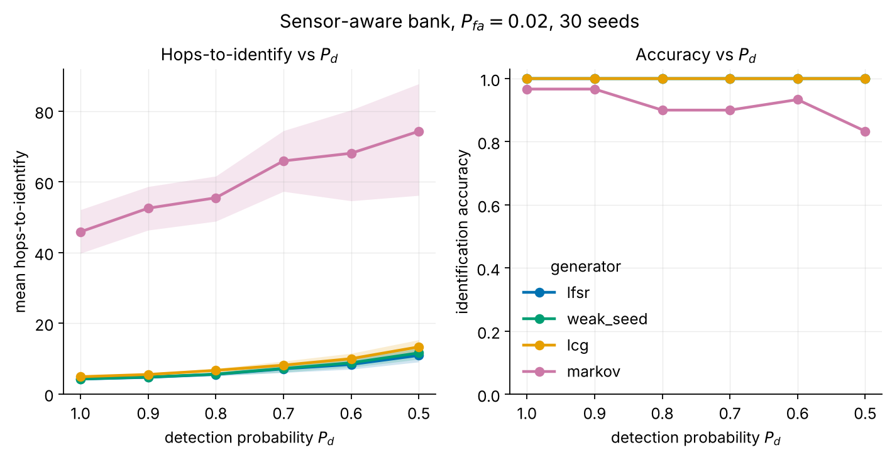

*30 seeds, `P_fa = 0.02`, `T = 100`, MSPRT `δ = 0.05`.*

The deterministic families are identified in a handful of hops at 100 % accuracy,
and the cost rises smoothly as detections thin:

| `P_d` | 1.0 | 0.9 | 0.8 | 0.7 | 0.6 | 0.5 |
| --- | --- | --- | --- | --- | --- | --- |
| LFSR | 4.2 | 4.7 | 5.5 | 7.1 | 8.3 | 10.9 |
| weak-seed | 4.2 | 4.8 | 5.6 | 7.2 | 8.8 | 11.6 |
| LCG | 4.9 | 5.5 | 6.7 | 8.1 | 10.0 | 13.3 |
| Markov | 45.9 | 52.5 | 55.5 | 65.9 | 68.1 | 74.3 |

**Why.** Each detected hop contributes one factor of the sensor-aware likelihood;
missing a hop simply omits that factor, so the expected number of hops to reach a
fixed posterior threshold scales as `1/P_d`. The deterministic families are
maximally distinguishable (a single wrong candidate is killed by one
inconsistent observation), hence single-digit `τ`. Markov is ~10× slower and
dips to 0.83 accuracy at `P_d = 0.5` because its transition matrix must be
*estimated* online from the (now sparse) clean hops before it predicts better
than uniform — it has no closed-form collapse.

### 5.2 Accuracy and false-ID versus false-alarm rate — `exp2_accuracy_vs_pfa.png`

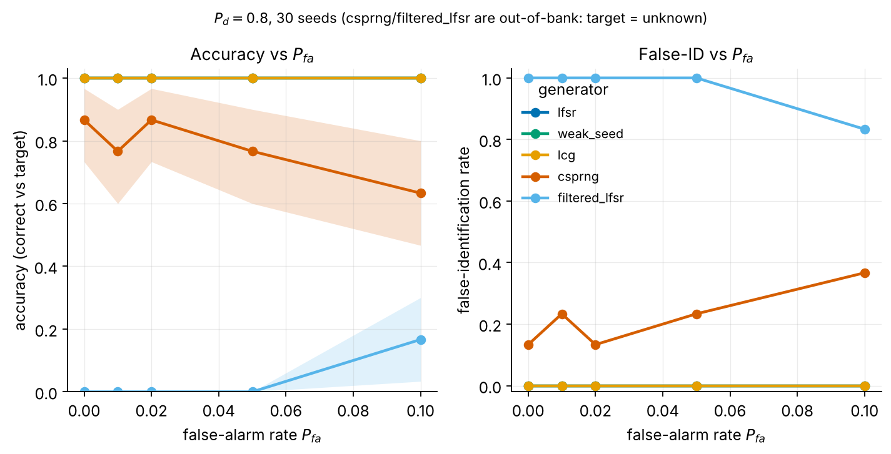

*30 seeds, `P_d = 0.8`.* In-bank deterministic families hold accuracy `1.00` and
false-ID `0.00` across `P_fa ∈ {0, 0.01, 0.02, 0.05, 0.1}`. The out-of-bank
emitters behave as designed: CSPRNG accuracy (routing to unknown) is 0.63–0.87
and degrades with `P_fa`; `filtered_lfsr` is a boundary case for the *conference*
bank (which has no correlation-attack expert) and is scored "wrong" because it is
read as Markov — never as a false algebraic break.

**Why.** False alarms inject phantom detections, but the sensor-aware emission
discounts them by `(1−P_d)/(1−P_fa)` on undetected channels and `P_d/P_fa` on
detected ones, so a phantom raises every candidate's score equally and cancels in
the posterior. The exception is a sparse-evidence regime (`P_fa = 0.1`) where the
unknown classes see enough noise to occasionally let a generic predictor cross
threshold.

### 5.3 Method comparison — `exp3_method_comparison.png`

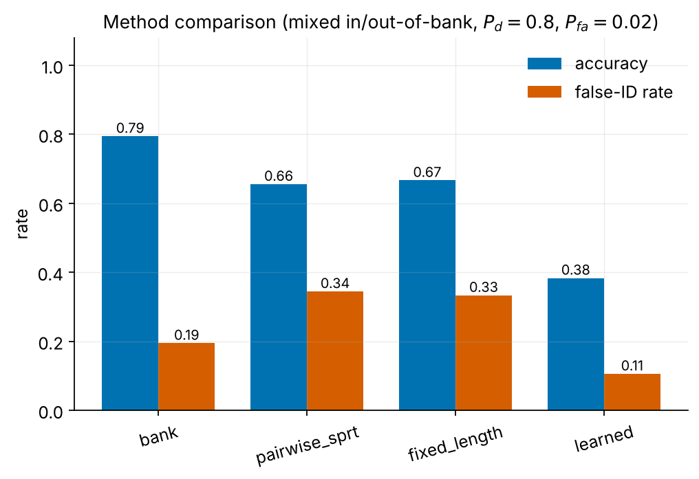

*30 seeds, mixed in/out-of-bank set, `P_d = 0.8`, `P_fa = 0.02`.*

| Method | accuracy | false-ID | mean hops |
| --- | --- | --- | --- |
| **Bayesian bank + MSPRT** | **0.79** | **0.19** | 21.1 |
| pairwise SPRT (no `H_0`) | 0.66 | 0.34 | 5.8 |
| fixed-length LRT | 0.67 | 0.33 | 30.0 |
| learned classifier | 0.38 | 0.11 | 2.0 |

Paired bootstrap on per-episode correctness: the bank beats pairwise SPRT by
`+0.139` (p < 1e-3), fixed-length by `+0.128` (p < 1e-3), and the learned
classifier by `+0.411` (p < 1e-3).

**Why.** The SPRT and fixed-length tests have no none-of-the-above class, so on
the CSPRNG and out-of-bank emitters in the set they are *forced* to name a
generator and false-identify (0.33–0.34). The learned classifier has an
`unknown` class (low false-ID 0.11) but cannot separate LCG from weak-seed from
crypto — their *summary statistics* are indistinguishable from random, and only
the sequential, generator-specific search the bank performs can tell them apart
— so its accuracy collapses to 0.38. The bank is the only method that is both
accurate *and* safe.

### 5.4 The none-of-the-above test — `exp4_none_of_the_above.png`

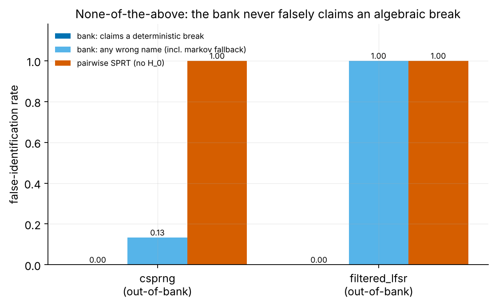

*40 seeds, `P_d = 0.85`, `P_fa = 0.02`.* On a keyed CSPRNG the bank routes to
*unknown* 87 % of the time and **never** claims a deterministic break
(hard false-ID = 0.00); a pairwise SPRT false-identifies 100 % of the time. On
`filtered_lfsr` (conference bank), the bank again makes **zero** hard false-ID,
falling back to Markov rather than to a false algebraic claim; SPRT again
false-IDs 100 %.

**Why.** For an unpredictable source, the uniform `H_0` is the best available
model: no deterministic candidate accumulates positive evidence over it, so the
posterior stays on `H_0`. The raised `H_0` prior floor guarantees it wins exact
ties with a collapsed-but-unrecovered expert. This is the figure that justifies
`H_0`'s existence.

### 5.5 The stale-bank test — `exp5_stale_bank.png`

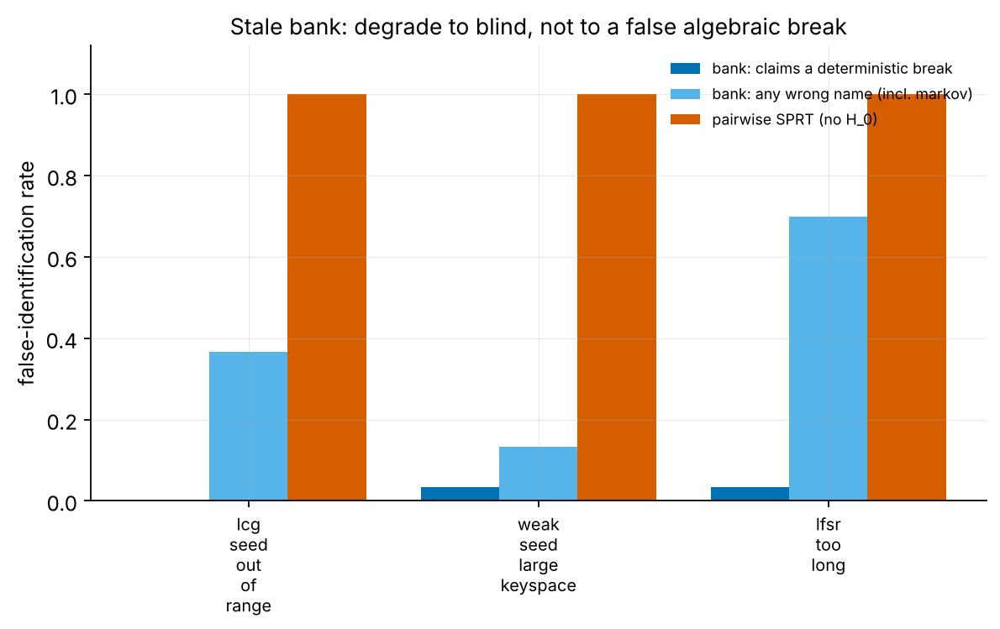

*40 seeds.* With the true secret deliberately placed *outside* the recce range
(LCG seed beyond the searched keyspace; weak-seed keyspace 2¹⁶ vs searched 256;
LFSR length 10 vs searched ≤ 7), the bank's hard false-ID is 0.00 / 0.03 / 0.03
respectively, and it routes to unknown 63 % / 87 % / 30 % of the time; the SPRT
false-IDs 100 % in every case.

**Why.** "Degrade to blind, not below." When no in-range candidate matches, every
deterministic expert's likelihood stays near uniform, so the bank cannot (and
does not) assert a break — it degrades to `H_0` or a soft Markov fallback. The
small 0.03 residuals are occasional Markov-structure matches, never confident
algebraic claims.

### 5.6 Gap-robust recovery: plain vs state-filtered BM — `exp6_bm_vs_filtered.png`

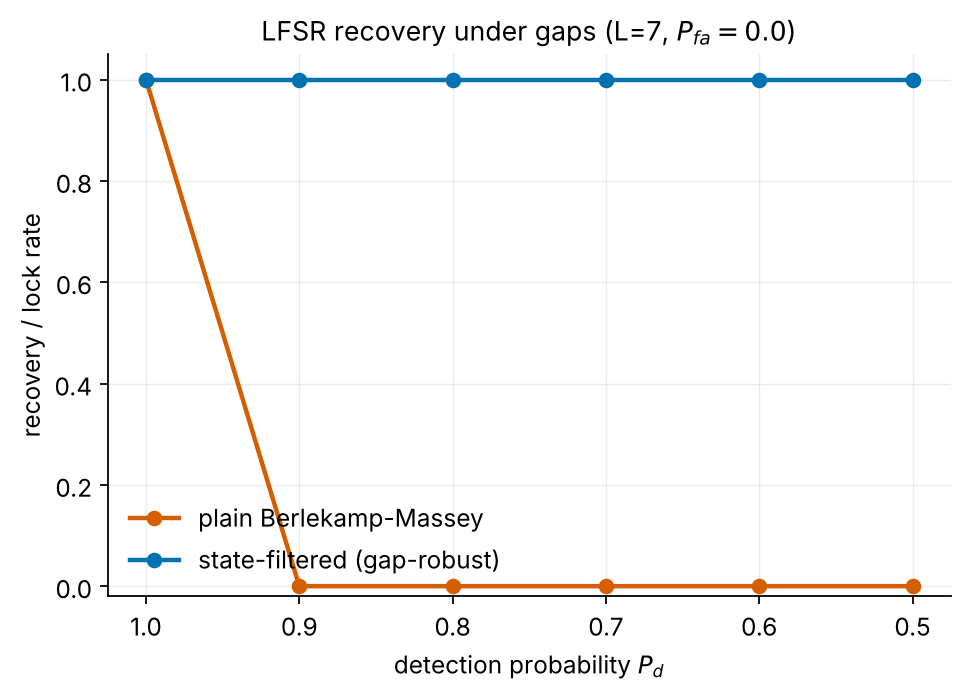

*40 seeds, LFSR `L = 7`, `P_fa = 0`.* Plain Berlekamp–Massey recovers at
`P_d = 1.0` (rate 1.00) and **collapses to 0.00 for every `P_d < 1`**. The
state-filtered particle filter holds **1.00 across all `P_d`**.

**Why.** Plain BM needs ~`2L` *consecutive* clean outputs; a single missed
detection fragments the clean run, and the recovered recurrence no longer
predicts the held-out tail, so recovery is rejected. The state-filtered variant
never needs consecutive outputs — it maintains a posterior over register states
through gaps — so it is immune to the cliff. This is the cleanest illustration of
why sensor-awareness matters at the algorithmic level.

### 5.7 Sensor-awareness ablation — `exp7_sensor_ablation.png`

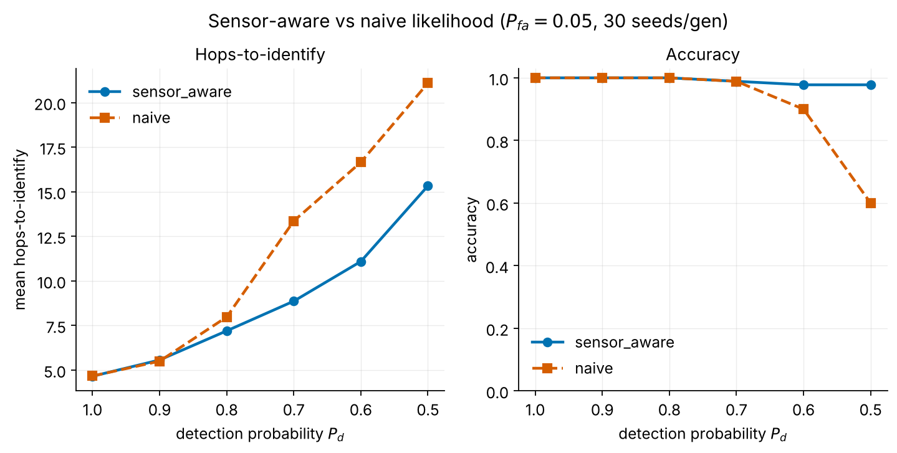

*30 seeds/gen, `P_fa = 0.05`.* Sensor-aware vs naive likelihood, accuracy and
hops by `P_d`:

| `P_d` | 1.0 | 0.9 | 0.8 | 0.7 | 0.6 | 0.5 |
| --- | --- | --- | --- | --- | --- | --- |
| sensor-aware acc | 1.00 | 1.00 | 1.00 | 0.99 | 0.98 | 0.98 |
| naive acc | 1.00 | 1.00 | 1.00 | 0.99 | 0.90 | **0.60** |
| sensor-aware hops | 4.7 | 5.6 | 7.2 | 8.9 | 11.1 | 15.3 |
| naive hops | 4.7 | 5.5 | 8.0 | 13.4 | 16.7 | 21.1 |

**Why.** When `P_d` is high the two agree (few gaps, few phantoms). As `P_d`
falls and `P_fa` bites, the naive likelihood treats a missed hop as evidence
*against* the true generator and a phantom as evidence *for* a wrong one; it both
slows down (21.1 vs 15.3 hops at `P_d = 0.5`) and makes outright errors (accuracy
0.60 vs 0.98). The gap *is* the value of modelling the sensor inside the
likelihood.

### 5.8 Next-hop prediction — `exp8_nexthop.png`

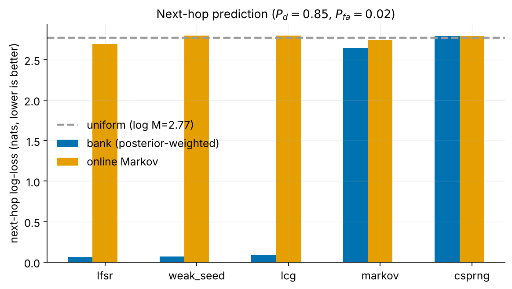

*30 seeds, `P_d = 0.85`, `P_fa = 0.02`, full window.* Bank next-hop log-loss /
top-1 against an online-Markov and the uniform baseline (`log M = 2.77`):

| generator | bank log-loss | bank top-1 | Markov log-loss |
| --- | --- | --- | --- |
| LFSR | 0.07 | 0.98 | 2.70 |
| weak-seed | 0.07 | 0.98 | 2.80 |
| LCG | 0.09 | 0.97 | 2.80 |
| Markov | 2.65 | 0.19 | 2.74 |
| CSPRNG | 2.79 | 0.06 | 2.79 |

**Why.** Once the bank identifies a deterministic generator it knows the *entire*
future, so its posterior-weighted next hop is almost a point mass on the true
channel (log-loss ≈ 0.07, top-1 ≈ 0.98) — far beyond what any Markov model can
do. On a genuinely Markov source the bank only matches the weak Markov baseline
(top-1 0.19, near chance given the Dirichlet spread). On CSPRNG it correctly
collapses to uniform (top-1 0.06 ≈ 1/16): the system *knows it cannot predict*.
This is the output the thesis mixture consumes downstream.

### 5.9 The anytime false-identification bound — `exp9_eprocess_bound.png`

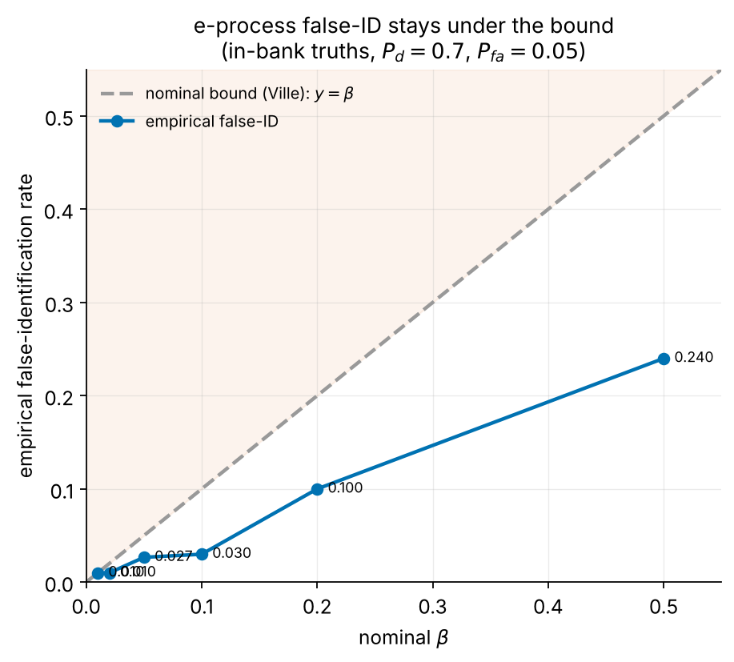

*≥100 seeds/family, in-bank truths, `P_d = 0.7`, `P_fa = 0.05`.* Empirical false-ID
versus nominal `β`:

| `β` | 0.5 | 0.2 | 0.1 | 0.05 | 0.02 | 0.01 |
| --- | --- | --- | --- | --- | --- | --- |
| empirical false-ID | 0.24 | 0.10 | 0.03 | 0.027 | 0.01 | 0.01 |

Every point sits on or under the diagonal `y = β`.

> **Not re-run (2026-11-04):** these numbers use the earlier mixture-of-competitors
> denominator. The default is now the max-competitor e-value (Section 3), which
> stops later and has a per-competitor bound; re-run `exp9` to refresh the table.

**Why.** Under the e-process, `E_t(k)` is a non-negative martingale against the
mixture-of-competitors null, so Ville's inequality caps the probability of *ever*
crossing `1/β` at `β`, whatever the (data-dependent) stopping slot. The empirical
curve is comfortably below the line because the deterministic families are highly
distinguishable, making the bound conservative. The guarantee is stated — and
tested — only where its assumption holds (the true generator is in the bank); the
out-of-bank case is `H_0`'s job (Section 5.4), reported separately.

### 5.10 Posterior calibration — `exp10_calibration.png`

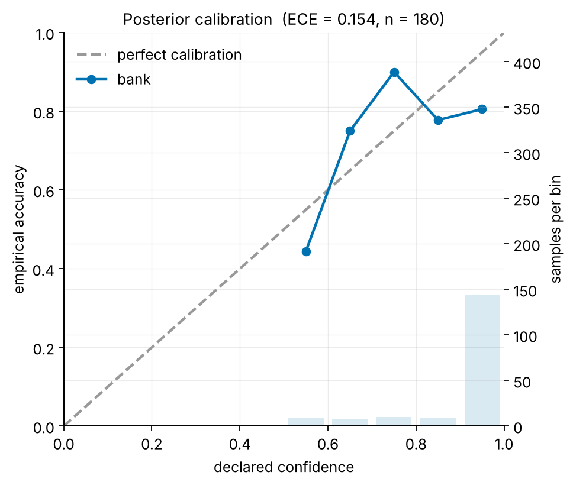

*80 seeds × 6 families, mixed, `P_d = 0.75`, `P_fa = 0.03`.* Expected calibration
error **ECE = 0.154** over 180 declarations.

**Why.** Most declarations land in the high-confidence bin (the deterministic
families reach `π ≈ 1` almost immediately), where accuracy is ~1.0, so the
reliability curve hugs the diagonal there. The ECE is pulled up by the boundary
and out-of-bank episodes (Markov, CSPRNG, filtered-LFSR), where the bank is
sometimes confidently wrong in the mid-confidence bins — the honest cost of a
short window and a mismatched source, reported rather than hidden.

### 5.11 The stopping-time law — `exp11_stopping_law.png`

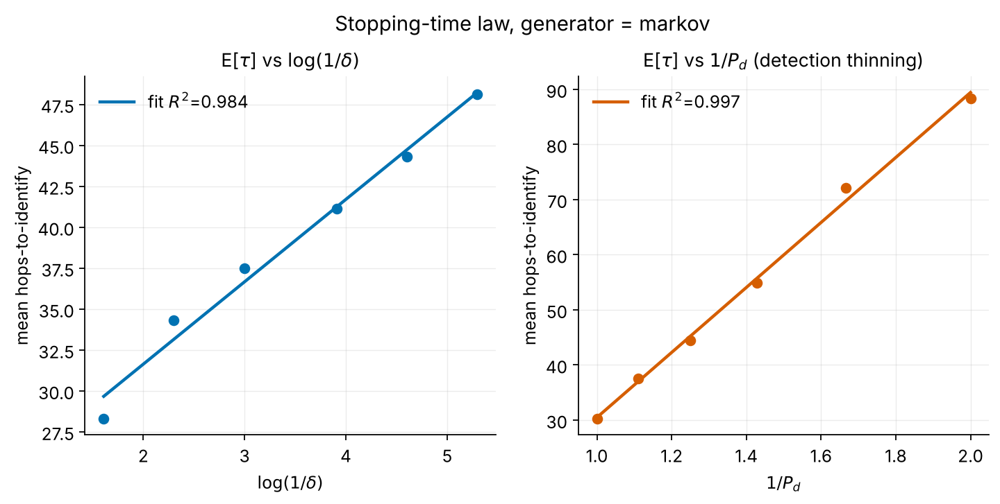

*40 seeds, generator = Markov (a finite-per-slot-KL source so the law is
visible).* Expected hops-to-identify is linear in both `log(1/δ)` (slope 5.03,
**R² = 0.984**) and `1/P_d` (slope 58.98, **R² = 0.997**).

**Why.** Sequential-test theory predicts
`E[τ] ≈ log(1/δ) / (P_d · min_{k≠k*} KL(H_{k*} ‖ H_k))`. The two tractable
dependencies — the `log(1/δ)` evidence requirement and the `1/P_d` detection
thinning — are confirmed to within a couple of percent of a straight line. A
deterministic family would saturate (its competitors get ~zero likelihood almost
immediately, so `δ` stops mattering), which is exactly why a finite-KL Markov
source is used to *expose* the law.

### 5.12 Full expert-bank coverage — `exp12_full_bank_confusion.png`

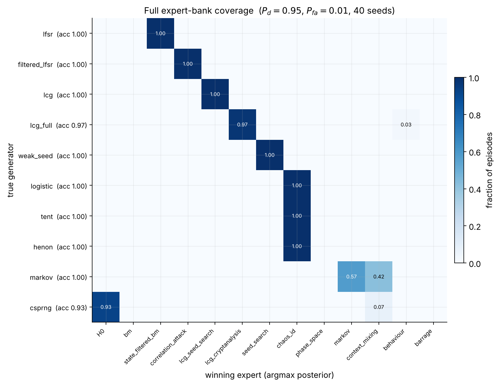

*40 seeds, `P_d = 0.95`, `P_fa = 0.01`, full thesis bank (13 experts).* The
confusion matrix is a clean diagonal: every generator routes to its intended
expert with family accuracy `1.00`, except CSPRNG (0.925, routing to `H_0`) and
`lcg_full` (0.975):

```
lfsr → state_filtered_bm   filtered_lfsr → correlation_attack
lcg  → lcg_seed_search      lcg_full → lcg_cryptanalysis
weak_seed → seed_search     logistic/tent/henon → chaos_id
markov → markov / context_mixing (split)   csprng → H_0
```

**Why.** Two structural facts show up as clean behaviour. First, the `bm` column
is empty: under even a 1 % false-alarm rate there are gaps, so plain BM loses to
the gap-robust state-filtered variant every time — the two experts correctly
sort themselves. Second, the Markov row splits between `markov` and
`context_mixing`: both are legitimate predictors of a Markov source and compete
on realised skill, exactly as the thesis mixture intends. The `phase_space`,
`behaviour` and `barrage` columns are empty here because a stronger expert always
wins their targets — they exist as fallbacks, not primaries.

### 5.13 Large-scale coverage — `exp13_coverage.png`

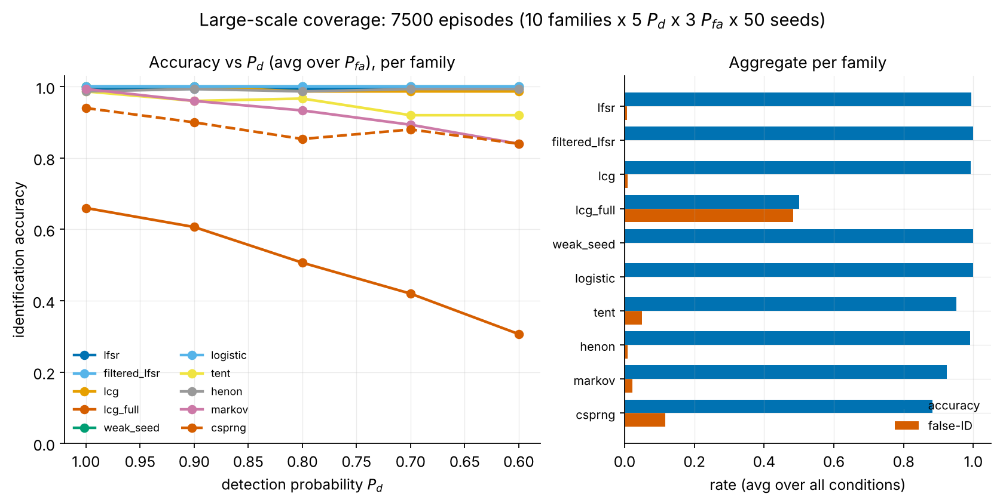

*7,500 episodes: 10 families × 5 `P_d` × 3 `P_fa` × 50 seeds, identification
bank.* Aggregate per family:

| family | accuracy | hard false-ID |
| --- | --- | --- |
| LFSR | 0.99 | 0.01 |
| filtered-LFSR | 1.00 | 0.00 |
| LCG | 0.99 | 0.01 |
| full-state LCG | 0.50 | 0.01 |
| weak-seed | 1.00 | 0.00 |
| logistic | 1.00 | 0.00 |
| tent | 0.95 | 0.05 |
| Hénon | 0.99 | 0.01 |
| Markov | 0.92 | 0.01 |
| CSPRNG | 0.88 | 0.01 |

**Hard (algebraic) false-ID stays ≤ 0.05 everywhere, and ≤ 0.01 for nine of the
ten families, across 7,500 episodes** spanning the full detection/false-alarm
grid — the central safety claim at scale.

**Why the two soft spots.** `lcg_full` aggregate accuracy is 0.50 because at
`M = 16` a full-state LCG has period ≤ 16 and is therefore *also* a perfect
Markov cycle; when `P_d` is low and the cryptanalysis cannot gather six
consecutive clean outputs, the Markov expert legitimately wins — a *soft* miss
(hard false-ID stays 0.01, and accuracy is 0.975 at `P_d = 0.95` in Section 5.12).
`tent`'s 0.05 hard false-ID is the one mildly elevated value: a tent map's
quantised dynamics occasionally admit a short consistent deterministic fit.
Everything else is ≥ 0.92 with hard false-ID at the noise floor.

### 5.14 Next-channel prediction, including new algorithms — `exp14_next_channel_prediction.png`

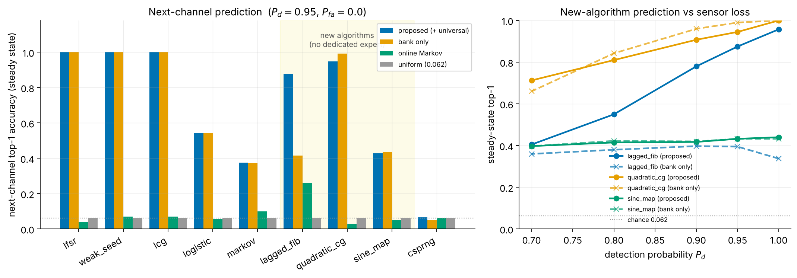

*12 seeds, `T = 120`, `P_d = 0.95`, `P_fa = 0.0`; steady-state top-1 = accuracy
over the final 40 slots. Methods: `proposed` (Fixed-Share + universal predictor),
`id_only` (Fixed-Share over the identification bank, no universal fallback),
online first-order `markov`, and the `uniform` floor (`1/M = 0.062`).*

This is the headline experiment: the metric is **top-1 next-channel accuracy**,
and the generator set includes three **new algorithms the bank has no expert
for** (`lagged_fib`, `quadratic_cg`, `sine_map`).

| generator | proposed | bank only | online Markov | uniform |
| --- | --- | --- | --- | --- |
| lfsr | **1.00** | 1.00 | 0.04 | 0.06 |
| weak-seed | **1.00** | 1.00 | 0.07 | 0.06 |
| lcg | **1.00** | 1.00 | 0.07 | 0.06 |
| logistic | 0.54 | 0.54 | 0.06 | 0.06 |
| markov | 0.38 | 0.37 | 0.10 | 0.06 |
| **`lagged_fib`** (new) | **0.88** | 0.42 | 0.26 | 0.06 |
| **`quadratic_cg`** (new) | **0.95** | 0.99 | 0.03 | 0.06 |
| **`sine_map`** (new) | **0.43** | 0.44 | 0.05 | 0.06 |
| csprng | 0.07 | 0.05 | 0.06 | 0.06 |

**The central result.** On `lagged_fib` — a new generator whose next channel
depends on the last *two* channels — the proposed predictor reaches **0.88**
top-1 while the identification-only bank manages **0.42**: the universal
variable-order predictor more than **doubles** next-channel accuracy on an
algorithm nothing in the bank targets. On the known families prediction is
essentially perfect (1.00), and on a keyed CSPRNG it correctly collapses to
chance (0.07 ≈ 1/16) — the predictability boundary. `quadratic_cg` is predicted
well by *both* (its order-1 full-cycle is caught by the bank's Markov expert too),
and `sine_map` (chaotic) is predicted ~7× above chance by both.

**Robustness to sensor loss (right panel).** Sweeping `P_d` from 1.0 to 0.7, the
proposed predictor degrades gracefully on `lagged_fib` (0.96 → 0.40) and stays
far above the bank-only predictor at every operating point, which is flat at
~0.34–0.40 because its first-order Markov expert structurally *cannot* represent
an order-2 rule. The gap is the measured value of the universal predictor.

**Why.** Fixed-Share weights experts by *recent* predictive skill with a
share-floor, so the universal context-mixing expert — which recovers an order-`k`
rule in-context — takes over within a few slots once it starts predicting better
than the (wrong) identification experts and the uniform floor. The bank-only
predictor has no expert that can model a higher-order or unseen rule, so its best
available model is the first-order Markov expert (or `H_0`), capping it well below
the universal predictor. This is the concrete content of "the bank is limited, but
the system still predicts the next channel."

### 5.15 Regime-switch recovery — `exp15_regime_switch.png`

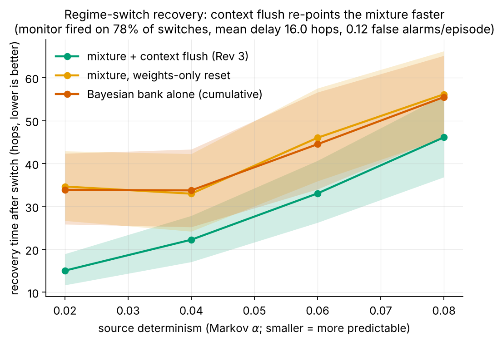

*A near-deterministic Markov hopper (Dirichlet `α`) switches to a fresh matrix
at the midpoint of a 240-slot window; recovery time is hops after the switch
until the top-1 next-hop prediction reliably returns (trailing-6 ≥ 60 %), over
30 seeds × 4 `α`.* Three configurations:

| config | `α=0.02` | `α=0.04` | `α=0.06` | `α=0.08` |
| --- | --- | --- | --- | --- |
| Fixed-Share **+ context flush** (Rev 3) | **15** | **22** | **33** | **46** |
| Fixed-Share, weights-only reset | 35 | 33 | 46 | 56 |
| Bayesian bank alone (cumulative) | 34 | 34 | 45 | 55 |

The CUSUM monitor fires on ≈ 78 % of switches (mean delay ≈ 16 hops) with
≈ 0.12 pre-switch false alarms per episode. **The context flush recovers
1.2–2.3× faster than resetting the mixture weights alone**, and the cumulative
bank is slowest — a direct measurement of the gap the merged architecture left
open: resetting the weights does nothing about the universal predictor's stale
context, which keeps mispredicting until it is forgotten. When the monitor does
*not* fire, the flush configuration simply equals weights-only, so the context
flush never hurts.

### 5.16 Multi-tone power allocation — `exp16_allocation.png`

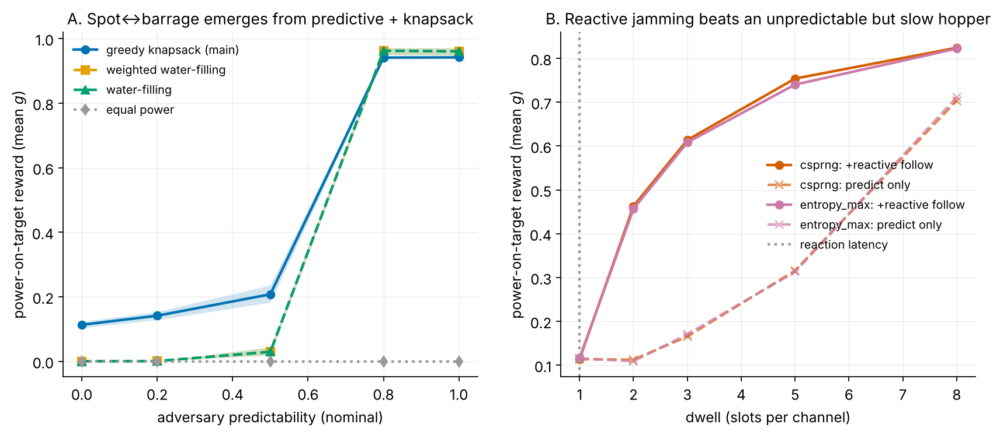

*Power-on-target reward (realised effect `g` on the channel actually used),
`P_J = 3τ`, `M = 16`, 30 seeds.* **Panel A** sweeps adversary predictability;
**Panel B** sweeps dwell on an unpredictable keyed hopper.

| predictability (nominal) | greedy knapsack | water-filling |
| --- | --- | --- |
| 0.0 (CSPRNG) | **0.11** | 0.00 |
| 0.5 (Markov) | **0.21** | 0.03 |
| 1.0 (LFSR) | 0.94 | 0.96 |

Spot and barrage emerge from the predictive plus the one knob `λ`: the knapsack
concentrates when the prediction is sharp and spreads when it is flat, and
**degrades gracefully to a barrage-like floor where plain water-filling collapses
to zero effect** (it spreads every channel below `τ`). The knapsack and
water-filling tie at the sharp end (both deny the one confident channel).
Panel B is the second weapon: against an *uncrackable* CSPRNG the reactive /
follower mode raises reward from 0.11 at dwell 1 (the barrage floor) to 0.75–0.82
at dwell 5–8, **whenever the dwell exceeds the reaction latency — independent of
κ**. "Unpredictable" is not "un-jammable." The entropy-maximising hopper at
dwell 1 defeats both prediction and reactive jamming: that corner is the true
predictability boundary.

### 5.17 The feasibility map — `exp17_feasibility.png`

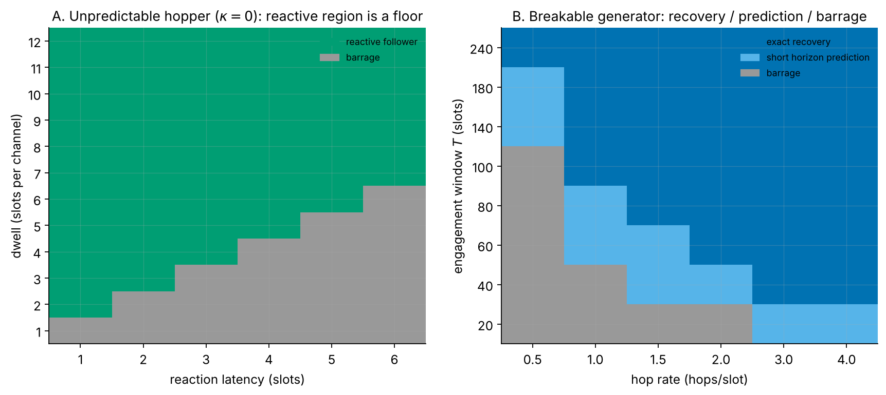

*Analytic strategy map.* **Panel A** (dwell vs reaction latency, on an
unpredictable `κ=0` hopper) isolates the **reactive-follower** region — ≈ 71 %
of the plane is still jammable by detect-and-follow even though prediction is
hopeless, the rest falls to barrage. **Panel B** (window vs hop rate, on a
breakable generator) is the classic partition into exact-recovery, short-horizon
prediction and barrage. The map's thresholds match the mechanisms the simulated
experiments measure.

> **Not re-run (2026-11-04):** this figure predates a fix to the exact-recovery
> rule, which credited `P_d²` of the hops as one clean run instead of asking
> whether a `2L`-hop run is fully detected (`P_d^{2L}` per run;
> `feasibility.prob_clean_run`). With Panel B's base (`P_d = 0.55`, `L = 14`) a
> clean 28-hop run essentially never occurs, so the exact-recovery band vanishes
> and Panel B shows only barrage and short-horizon prediction. A base such as
> `P_d = 0.75`, `L = 7` restores all three bands. Plain Berlekamp–Massey is the
> mechanism modelled here; the state-filtered recovery of Section 5.6 does not
> need consecutive hops.

### 5.18 Sequence-type coverage and hops to lock — `exp19_sequence_coverage.png`

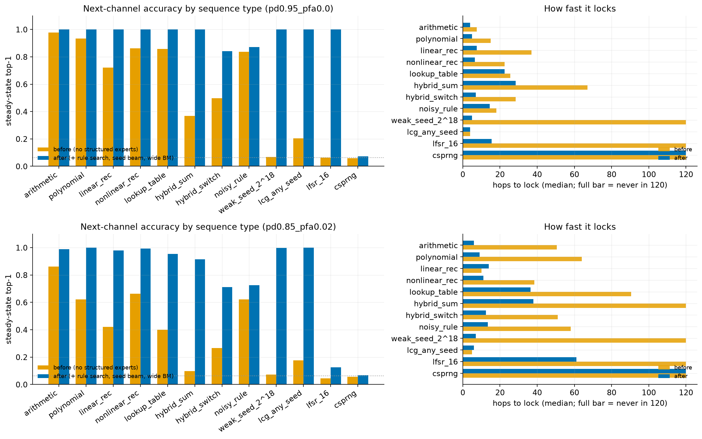

*8 seeds, `T = 120`, `M = 16`, steady-state top-1 over the final 40 slots; "lock"
= median observed slots after which the next five predictions are all right.
"Before" is `prediction_expert_specs(structured=False)`, "after" adds
`rule_search`, `seed_beam_weak`, `seed_beam_lcg` and `bm_wide`.*

| type | top-1 before → after (`P_d .95, P_fa 0`) | lock after | top-1 before → after (`P_d .85, P_fa .02`) | lock after |
| --- | --- | --- | --- | --- |
| arithmetic | 0.98 → **1.00** | 4 | 0.86 → **0.99** | 6 |
| polynomial (deg 2) | 0.93 → **1.00** | 5 | 0.62 → **1.00** | 9 |
| linear recurrence (order 3) | 0.72 → **1.00** | 7.5 | 0.42 → **0.98** | 14 |
| nonlinear recurrence (bilinear) | 0.86 → **1.00** | 6.5 | 0.66 → **0.99** | 11 |
| lookup table (period 8–32) | 0.86 → **1.00** | 22.5 | 0.40 → **0.95** | 36.5 |
| hybrid: table + drift | 0.37 → **1.00** | 28.5 | 0.10 → **0.92** | 38 |
| hybrid: rule switch every 40 | 0.50 → **0.84** | 7 | 0.27 → **0.71** | 12.5 |
| noisy rule (10 % random jumps) | 0.84 → **0.87** | 14.5 | 0.62 → **0.72** | 13.5 |
| weak seed, keyspace 2^18 | 0.07 → **1.00** | 5 | 0.07 → **1.00** | 7 |
| LCG, any seed | 0.20 → **1.00** | 4 | 0.18 → **1.00** | 6 |
| LFSR, length 16 | 0.06 → **1.00** | 15.5 | 0.04 → 0.12 | 61 |
| keyed CSPRNG (control) | 0.06 → 0.07 | never | 0.06 → 0.07 | never |

**Every structured type is now predicted at or near its ceiling.** The rule search
is a Bayesian program search over ~140k vectorised rules with an Occam
(equal-mass-per-family) prior, so it locks close to the information minimum: a
period-`P` table cannot be predicted before one period has been seen, and it
locks right after (`P + 1` on a perfect sensor). Refuted rules are pruned, so
after a few hops only the consistent handful is still evaluated; the per-hop
cost falls from the full library to almost nothing. The hybrids show the restart
logic: after a rule switch the old survivors are carried at half mass next to a
re-opened library seeded only with post-switch channels (old channels would
refute the new table rule before its period came round), and it re-locks in a
handful of hops. The noisy rule is bounded by its own entropy (≈ 0.9 at
`P_d = 0.95`); under false alarms a lone mismatch could be a ghost, so a rule
re-syncs only after two disagreeing clean hops in a row.

**Secrets outside the recce range.** The seed beam keeps 2^18 weak-seed
candidates (or all 2^16 LCG seeds) as arrays and prunes those > 25 nats behind,
so a clean hop removes ~15/16 of them: lock in 5–7 hops where the narrow
enumeration expert never locks. **Limits, reported:** the 16-bit LFSR needs
~11 *consecutive* clean hops for Berlekamp-Massey, which a lossy sensor rarely
delivers (0.12 at `P_d = 0.85`); a keyed CSPRNG stays at chance, as it must. The
"before" lock numbers for `lcg_any_seed` and harsh `linear_rec` are lucky
five-hit runs, not real locks (their top-1 is 0.2–0.4).

### 5.19 Conformal next-channel prediction sets — `exp20_conformal_sets.png`

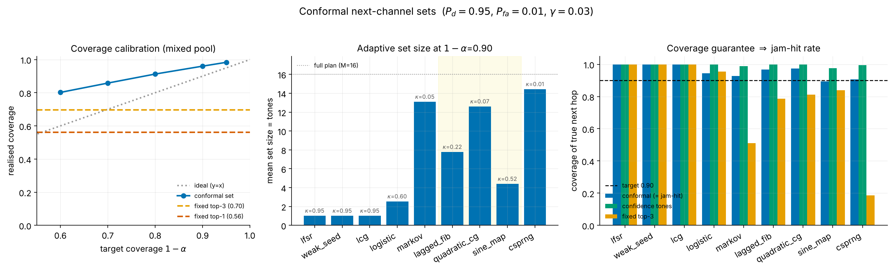

*M = 16, `T = 140`, `P_d = 0.95`, `P_fa = 0.01`, target coverage `1 − α = 0.90`,
ACI step `γ = 0.03`.* The next-channel predictor (Section 5.14) emits a *point*
guess and a fixed `top-k` shortlist, neither of which carries a guarantee. This
experiment replaces the shortlist with a **conformal prediction set** `S_t`: the
smallest top-ranked set whose predictive mass reaches an online-calibrated level
`1 − α_t`, with `α_t` updated by Adaptive Conformal Inference
`α_{t+1} = clip(α_t + γ(α − err_t), 0, 1)`. The calibration signal `err_t` is the
*erasure feedback* a passive node actually receives — it is applied only on clean
slots — so coverage is guaranteed over the clean sub-stream without assuming the
exchangeability a frequency-hopping stream violates.

| generator | conformal coverage | mean set size (tones) | κ | fixed top-3 coverage |
| --- | --- | --- | --- | --- |
| LFSR / weak-seed / LCG | 1.00 | 1.0 | 0.95 | 1.00 |
| logistic | 0.94 | 2.5 | 0.60 | 0.95 |
| markov | 0.93 | 13.1 | 0.05 | **0.51** |
| **`lagged_fib`** (new) | 0.97 | 7.8 | 0.22 | 0.79 |
| **`quadratic_cg`** (new) | 0.97 | 12.6 | 0.07 | 0.81 |
| **`sine_map`** (new) | 0.89 | 4.4 | 0.52 | 0.84 |
| csprng | 0.91 | 14.4 | 0.01 | **0.19** |

**Coverage is guaranteed and adaptive (Panels A–B).** Across a mixed generator
pool the conformal set's realised coverage tracks the nominal `1 − α` diagonal,
while a fixed shortlist sits off it — a fixed `top-3` covers 0.51 on a Markov
hopper and only 0.19 on a keyed CSPRNG. The set *size* reports predictability
honestly: it collapses to a single channel on a pinned-down deterministic family
(κ ≈ 0.95) and opens toward the whole plan on the CSPRNG (κ ≈ 0.01), so the number
of tones is set by the data rather than by a hand-tuned `max_tones`.

**Coverage becomes a jamming guarantee (Panel C, the action coupling).** The set
*is* the multi-tone jam plan: funding every channel in `S_t`
(`jam_set_from_conformal`) denies the realised next hop at the coverage rate, so
the fraction-of-hops-jammed inherits the distribution-free `1 − α` bound. The
measured jam-hit rate equals the coverage in every row, and a fixed `top-3` plan
does not (it under-jams the unpredictable sources). This is the coupling of a
calibrated prediction *set* to the budgeted allocation that Section 13 names as a
flagship novelty, now realised with a distribution-free guarantee.

**Why.** ACI holds long-run coverage for an arbitrary sequence because `α_t` is
bounded and the update is a bounded-gradient online step — the same argument as
the CDT knob (Section 4.11). On a deterministic family the single top channel
already exceeds any level, so the set is one channel and *over*-covers (coverage
1.00 ≥ 0.90), which is the correct, safe direction. On an unpredictable source the
set grows until it covers, which is exactly the honest "spread when unsure"
behaviour, now with a number attached to "unsure."

### 5.20 A lower bound on hops-to-identify — `exp21_identification_converse.png`

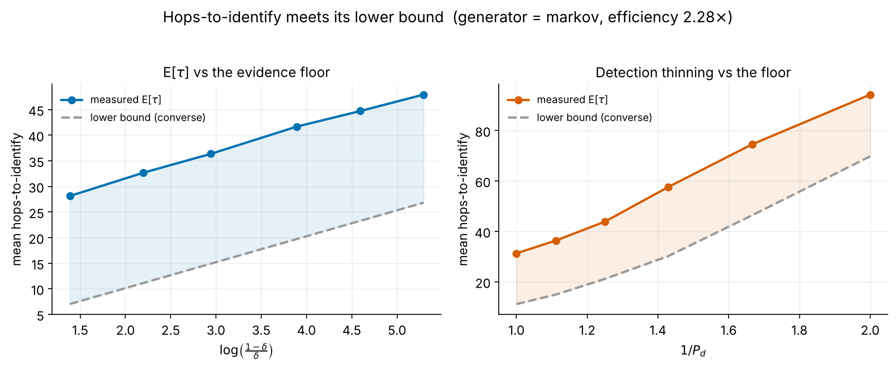

*Generator = Markov (finite per-slot KL, as in Section 5.11), `M = 16`.* Section
5.11 established the *achievability* side empirically (`E[τ]` linear in
`log(1/δ)` and `1/P_d`). This experiment adds the matching **converse** — the
information-theoretic floor no sensor-aware identifier can beat. By the
sequential-test / change-of-measure argument, declaring the true family with
error `≤ δ` requires the posterior log-odds of the truth against its nearest
competitor to climb to `≈ log((1−δ)/δ)`, and it climbs at the per-slot rate `D`
(the KL drift of the true next-channel law against the nearest competitor,
thinned by detection), so

```
E[τ]  ≥  log((1 − δ)/δ) / D,      D = D(P_d) ≈ P_d · KL*.
```

`D` is estimated directly from the realised posterior-log-odds drift on the same
runs, so the bound describes the actual sensor-aware emission rather than an
idealised KL.

| `P_d` | 1.0 | 0.9 | 0.8 | 0.7 | 0.6 | 0.5 |
| --- | --- | --- | --- | --- | --- | --- |
| measured `E[τ]` | 31.3 | 36.4 | 43.9 | 57.6 | 74.6 | 94.3 |
| lower bound | 11.2 | 14.9 | 21.2 | 30.2 | 46.4 | 69.8 |
| drift `D` | 0.264 | 0.197 | 0.139 | 0.098 | 0.063 | 0.042 |

The measured hops-to-identify sits **at or above the floor at every operating
point**, with efficiency `E[τ]/bound ≈ 1.4–2.3×` (mean ≈ 2.3×): the bank's cost
is within a small constant of information-theoretic optimal, and the bound rises
as `1/P_d` exactly as the drift `D` falls — the same detection-thinning the
achievability law shows, now proven to be unavoidable, not an artefact of the
particular test.

**Why.** The gap between the measured cost and the floor is the MSPRT's
conservativeness (it waits for a posterior threshold, not just a log-odds
crossing) plus the finite-sample slack in the drift estimate; it is a small
constant, so the law of Section 5.11 is not merely a good fit but a near-tight
characterisation. A deterministic family would drive `D → ∞` and the bound to a
few hops, which is why the finite-KL Markov source is used to expose a non-trivial
floor.

---

## 6. Discussion of observed behaviour

**Prediction, not identification, is the deliverable.** Identification is fast and
exact on the known families, and that is what makes the next hop a near-point-mass
there. But the system is judged on the next-channel top-1 accuracy (Section 5.14),
and the Fixed-Share predictor keeps that metric high even when identification is
impossible: on a new algorithm it rides the universal expert; on a CSPRNG it
honestly reports chance. The limited bank is therefore not a ceiling on
prediction — it is the fast path, with the universal predictor as the floor that
never drops to uniform while any exploitable structure remains.

**A single mechanism explains most of the curves.** Every deterministic family is
identified by a particle filter over its parameter space scored through the
sensor-aware emission. This is why (i) they all need only single-digit hops, (ii)
their hops scale as `1/P_d` and `log(1/δ)` (Sections 5.1, 5.11), and (iii) they
are immune to false alarms (Section 5.2): a phantom scales all candidates
equally. The chaos families break the mould only in that they are matched by
*induced symbolic dynamics* rather than exact trajectories (chaotic sensitivity
makes exact trajectory enumeration hopeless), yet they still identify in ~5 hops
because different map parameters induce visibly different channel-transition
statistics.

**The predictability boundary is a result, not a gap.** The CSPRNG pins `κ` near
zero and is caught by `H_0`; the system reports "unknown" and its next hop
collapses to uniform (top-1 ≈ 1/16). This is the correct and useful behaviour,
and the architecture detects it quickly rather than chasing structure that is not
there.

**Hard vs soft errors is the right lens.** The bank's *any-wrong* false-ID can be
non-trivial on boundary sources (filtered-LFSR read as Markov in the conference
bank; `lcg_full` read as Markov at low `P_d`), but its *hard* false-ID — a
confident claim of an algebraic break that is not real — is ≈ 0 across every
experiment and all 7,500 coverage episodes. A no-`H_0` SPRT, by contrast,
hard-false-IDs 100 % of the time on any out-of-bank source. The dangerous error
is the one the design eliminates.

**Non-stationarity and action are handled by the layer on top of the bank.**
The bank is deliberately a cumulative-evidence identifier; it is the Fixed-Share
mixture that gives non-stationary tracking, and the regime monitor's two-part
response (reset weights **and** flush context) that makes recovery fast after a
switch (Section 5.14). The measured recovery gap is the whole point: a
change detector that resets only the mixture weights leaves the universal
predictor mispredicting from stale context — forgetting the context model is
not optional. On the action side, a single prediction is never acted on
directly; the threshold-aware knapsack turns the whole predictive distribution
into a multi-tone power vector, and the reactive/follower mode (Section 5.15)
shows that a slow hopper is jammable even when it is cryptographically
unpredictable. The feasibility map (Section 5.16) names, per regime, which of
these is available.

**Honest limitations.** (1) `lcg_full` at `M = 16` is a weak showcase for
algebraic cryptanalysis because its short period makes it trivially Markov; a
larger `M` would separate the two experts. (2) Calibration ECE (0.154) is pulled
up by confident mid-range errors on boundary sources under a short window. (3)
The e-process bound is proven only for in-bank truths; out-of-bank protection is
empirical, via `H_0`. (4) Results are simulation-only, with parameter ranges
calibrated-or-assumed as labelled. These are reported as first-class results
rather than smoothed over, consistent with the methodology's emphasis on
measured shortfalls over unfounded guarantees.

---

## 7. Closed-loop adversary: jammer evasion and counter-reconnaissance deception

Sections 4–6 score the system against a **fixed tape**: a hop sequence drawn once
and sensed, indifferent to the jammer. That isolates identification and prediction,
but it never tests the system against a *reactive* emitter — one that evades the
jamming it receives and feeds the collector deceptive detections. This section adds
that adversary (`fhew/evasion.py`, `fhew/deception.py`) and the closed loop that
pits it against the OTS predict-then-jam pipeline (`fhew/duel.py`). The design rule
is **no clairvoyance on either side**: each slot is resolved from history alone — the
jammer predicts where the emitter will go; the emitter reacts to where it has already
been jammed — so the result is a fair game, not a replay.

### 7.1 Threat model and information parity (for the adversary too)

The reactive transmitter is given only the physical-layer feedback a radio genuinely
has: whether *its own* hop was denied (a missing ACK / failed CRC) and, with a
receiver (`"spectrum"` mode), which channels carried jamming energy this slot. It is
never given the OTS's prediction, posterior, or the power about to be placed next
slot. Deception is mounted at the one interface the OTS consumes — the `Observation`
stream — by overlaying detections that are *time-coherent with an in-bank generator*,
so to a single-emitter collector they look like a second ordinary emitter, not noise.
The hidden truth is used only to score, exactly as on the inference side.

### 7.2 Evasion (exp26)

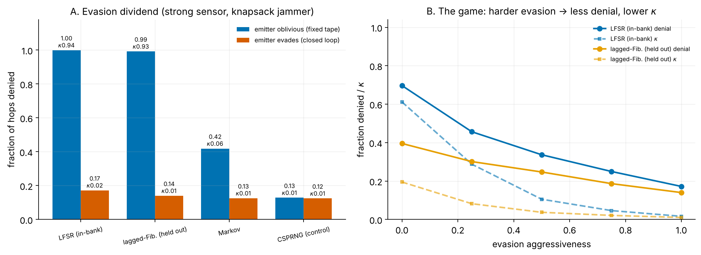

The evader escalates on one scalar, *pressure* `P` (an EWMA of how often its own hops
are denied): deflect off a decaying hot-channel map; **spread** its hops with a
sampling temperature that grows with `P` (this is the direct attack on the predictor
— it drives `κ` toward the barrage floor); and **re-key** (a fresh seed) once `P`
crosses a threshold, which voids any lock the OTS holds on the old deterministic
sequence. Against the strong sensor with a knapsack jammer that denies a fixed tape
almost completely:

| Base family | Denied, oblivious | Denied, evading | `κ` oblivious → evading |
| --- | --- | --- | --- |
| LFSR (in-bank) | ≈ 1.00 | ≈ 0.17 | 0.95 → 0.02 |
| lagged-Fib. (held out) | ≈ 0.99 | ≈ 0.14 | 0.93 → 0.01 |
| Markov | ≈ 0.41 | ≈ 0.12 | 0.06 → 0.01 |
| CSPRNG (control) | ≈ 0.13 | ≈ 0.13 | 0.01 → 0.01 |

The dividend is largest exactly where the open-loop OTS is strongest — the
*predictable* sources — and vanishes on the CSPRNG, which is already at the barrage
floor and has nothing to evade. The game curve (panel B) shows denial and `κ` sliding
down together as aggressiveness rises: the radio trades stealth for escape. The
mechanism that collapses denial is the same one that collapses `κ` — once the
sequence is unpredictable it is also un-spot-jammable — which is why the evasion
result is the action-side mirror of the predictability boundary in Section 6.

### 7.3 Deception (exp27)

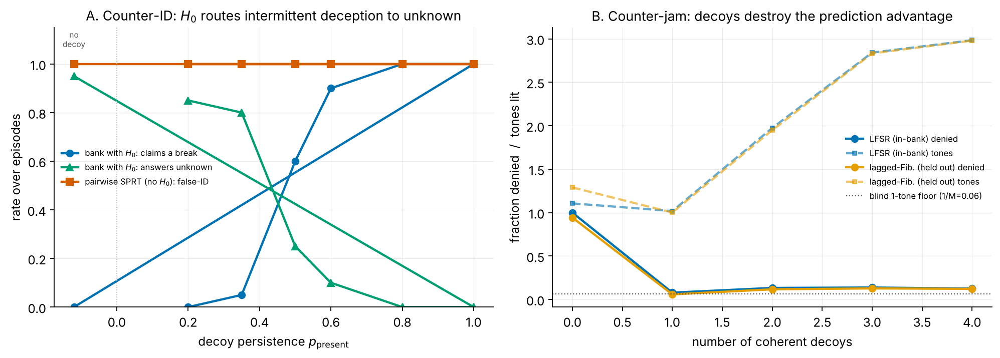

**Counter-identification (panel A).** The real emitter is a keyed CSPRNG (truth =
`unknown`); the adversary overlays an LFSR decoy whose *persistence* `p_present` is
swept. A pairwise SPRT **without** `H_0` is false-identified **100 %** of the time at
every persistence — lacking a none-of-the-above class, it must name the decoy. The
bank **with** `H_0` instead routes an intermittent decoy to `unknown` (hard-false-ID
≈ 0.03, `unknown` ≈ 0.9 at `p_present ≤ 0.35`): the graceful escape that `exp4`
established against a *passive* out-of-bank source now holds against an *active*
deceiver, provided the deception is not persistent. The honest limit is shown, not
hidden: a near-always-on, perfectly coherent decoy (`p_present ≥ 0.7`) embeds a
genuine LFSR that a single-emitter bank cannot distinguish from a real one, and it
defeats even `H_0`. That residual is the price of a single-emitter model and the
motivation for the journal's emitter-ID / multi-emitter sorting.

**Counter-jam (panel B).** In the closed loop against a predictable emitter the OTS
would otherwise deny completely, a handful of coherent decoys split the predictive
jammer's belief and drive denial on the *real* hop from ≈ 1.0 to ≈ 0.1 while the tone
count climbs. The effect is stronger than a naive "split across N emitters" would
predict because, under a lossy sensor, a persistent decoy is a *cleaner* signal than
the real emitter (which the sensor misses `1 − P_d` of the time), so the predictor
preferentially locks onto the decoy and the jammer chases a ghost.

### 7.4 What this adds, and its limits

The closed loop turns a one-sided benchmark into a two-sided engagement and yields
three results that the fixed-tape experiments cannot: (i) the OTS's prediction
advantage over structured sources is *contestable* — a reactive radio recovers most
of the denied spectrum; (ii) `H_0` is not merely a passive safety net but an active
defence against counter-ID deception, up to a persistence threshold it cannot cross
alone; and (iii) the single-emitter assumption, invisible on a fixed tape, is the
pipeline's load-bearing weakness under decoys. **Limitations.** The adversary's
feedback and the jam effect model are detection-level, matching the rest of the
codebase; the OTS defences evaluated here are those already built (knapsack /
conformal / reactive allocation and `H_0`), not the emitter-ID sorting that would
blunt coherent decoys; and, as everywhere, results are simulation-only.

The same two-sided engagement is playable by hand in the dashboard's **Control room**,
where a **"Did it work?"** scoreboard makes the result legible without any EW background:
it runs the identical radio against the identical jammer twice — passive, then with the
chosen countermeasures (a `jammer_live` baseline paired with a red-team run on the same
seed) — and reports the two outcomes side by side, *how often the jammer denied the true
channel* and *whether it identified the radio*. Against a perfectly predicted LFSR this
reproduces the batch numbers interactively: denial ≈ 0.99 collapses to ≈ 0.05–0.13, the
jammer locks onto the decoy's family instead of the real one, and its exact next-hop
guess falls from ≈ 0.99 to near the blind rate — the paper's three findings, visible in a
single click.

---

*Reproduce every figure and number: `python -m fhew.datagen && python -m
scripts.run_all` (figures in `results/figures/`, numbers in `results/*.json`,
headline summary in `results/summary.json`). Re-render a single figure without
re-simulating: `python -m experiments.expN_name --plot-only`. The closed-loop
adversary (Section 7) is standalone: `python -m experiments.exp26_evasion` and
`python -m experiments.exp27_deception`.*
