# Sensor-Aware Hypothesis Bank for FH Generator Identification — Methodology and Results

*Companion write-up for the `fhew` codebase. All figures referenced below are the
files in `results/figures/`, regenerated from saved results by
`python -m scripts.run_all`. Every number quoted is taken from the saved result
JSONs in `results/`; seed counts and sensor conditions are stated per experiment.*

---

## 4. Methodology

### 4.1 Problem formulation and notation

A single frequency-hopping emitter transmits, at each slot `t = 1 … T`, on one
channel `c_t` drawn from a known channel set `C` of size `M`. The channel is
chosen by an unknown **generator** `G` — a deterministic or stochastic process
(an LFSR, an LCG, a chaotic map, a keyed CSPRNG, …). A passive sensor observes
the emitter imperfectly and produces, each slot, a set of detections `o_t`. The
system must, within a short window of `T` slots, maintain a posterior over a
**bank of candidate generator mechanisms** and, when confident, declare an
identity — or declare *unknown* when the true mechanism is not in the bank.

| Symbol | Meaning |
| --- | --- |
| `C`, `M` | Channel set and its size (default `M = 16`, a power of two) |
| `c_t` | True channel at slot `t` (hidden; sensed only through the sensor) |
| `o_t` | Sensor output at slot `t`: a set of `(channel, …)` detections |
| `G` | True generator (unknown) |
| `H_k` | Hypothesis that the generator is family `k`, `k = 1 … K` |
| `H_0` | None-of-the-above (unknown generator) |
| `P_d`, `P_fa` | Detection probability; per-channel false-alarm rate |
| `π_t(k)` | Posterior probability of `H_k` after `t` slots |
| `τ_stop` | Slot at which an identity is declared |
| `δ`, `β` | MSPRT posterior threshold; e-process error bound |
| `κ_t` | Predictability score, `1 − H(p̂_t)/log M` |

**The information-parity principle (the central methodological constraint).**
Because the same simulator generates both the adversaries and the experts, a
likelihood could trivially "cheat" by reading the true seed, register length, or
family. We forbid this structurally: an expert sees *only* the stream of
`Observation` objects and its own reconnaissance configuration (which families
to consider, and bounded parameter ranges). It never receives the true channel
sequence or the generator instance. This is enforced in code — the simulator
hands the bank only observations — and is audited behaviourally (Section 5.14):
a secret placed *outside* the searched range is provably not identifiable, which
would be impossible if side information leaked.

### 4.2 Sensor model and the reduced emission

The sensor is modelled at the **detection level**, not at IQ level. Each slot,
the true channel `c_t` produces a detection with probability `P_d`; every other
channel independently produces a false detection with probability `P_fa`. The
observation schema is frozen as v1: a detection is
`(slot, channel, power, bearing, emitter_id)`, with the last three optional.

For a hypothesised true channel `s`, the per-slot emission factorises. Writing
`D_t ⊆ C` for the set of detected channels,

```
P(o_t | c_t = s) = [ P_d if s∈D_t else (1−P_d) ] · ∏_{c≠s} [ P_fa if c∈D_t else (1−P_fa) ].
```

Factoring out the all-false-alarm constant
`F_t = ∏_c P_fa^{1[c∈D_t]} (1−P_fa)^{1[c∉D_t]}` (identical for every hypothesis
and every slot) leaves the **reduced emission**

```
log e_t(s) = log ratio(s),   ratio(s) = (P_d/P_fa)      if s∈D_t
                                       = (1−P_d)/(1−P_fa) otherwise.
```

`F_t` cancels in the posterior over hypotheses and in every likelihood ratio, so
the bank works entirely with `log e_t(s)`. This vector is numerically stable and
is used twice — once to *generate* observations and once inside *every*
likelihood — which is the formal content of the phrase "sensor-aware."

### 4.3 The generator library (the truth side)

The simulator draws emitters from a registry of families. Each is a value
object with a `next_channel()` recurrence; none is ever exposed to the bank.

| Family | Structure | Hidden parameters |
| --- | --- | --- |
| `lfsr` | Fibonacci LFSR; channel = `b = log₂M` output bits | length `L`, taps, state |
| `filtered_lfsr` | LFSR through a degree-3 nonlinear Boolean combiner | `L`, taps, filter taps, state |
| `lcg` | `x ← (a x + c) mod m`; channel = high bits | `m, a, c, seed` |
| `lcg_full` | full-state LCG, channel = state (`m = M`) | `a, c, seed` |
| `weak_seed` | SplitMix64 PRNG with small keyspace | seed ∈ `[0, keyspace)` |
| `markov` | first-order Markov hopper (Dirichlet rows) | transition matrix |
| `logistic`, `tent`, `henon` | chaotic maps, quantised to channels | map parameter, `x₀` |
| `csprng` | SHA-256 counter mode, keyed | the key |

### 4.4 The expert bank (the hypothesis side)

Each expert is a `Hypothesis` implementing a common interface —
`step(log_emission) → (loglik, next_hop)`, `predict_next()`, `reset()`, and an
optional `observe_clean(channel)` — so the bank treats them uniformly and the
thesis mixture can later weight any of them by realised skill.

| Expert | Target | Mechanism |
| --- | --- | --- |
| Berlekamp–Massey (`bm`) | LFSR | algebraic collapse from clean *consecutive* outputs |
| State-filtered BM | LFSR under gaps | particle filter over register states |
| LCG cryptanalysis | `lcg_full` | algebraic recovery of `(a, c)` |
| Seed search | weak-seed | enumerate the keyspace |
| Correlation attack | filtered LFSR | enumerate register state of a known filter family |
| Parametric chaos ID | logistic/tent/Hénon | posterior over induced symbolic-dynamics models |
| Phase-space predictor | unknown chaotic | delay embedding + k-NN |
| Markov / n-gram | empirical regularity | online-fitted transition |
| Context-mixing (zero-shot) | any learnable, gap-robust | variable-order Markov mixture |
| Behaviour model | reactive/learned policy | recency-weighted predictor |
| Prior-weighted barrage | none assumed | the zero-hop floor |
| `H_0` | none-of-the-above | uniform / occupancy / Markov floor |

The deterministic families (LFSR, filtered LFSR, LCG, weak-seed) are realised by
a single unifying device: a **particle filter over the family's parameter
space**. Each candidate parameterisation is one particle producing a
deterministic channel trajectory; the forward pass marginalises over them. For
small register lengths this enumeration *is* the gap-robust "state-filtered
Berlekamp–Massey," and it generalises verbatim to seed search and the
correlation attack.

### 4.5 The sensor-aware forward filter

Every likelihood is a one-step-ahead (prequential) predictive score formed from
a prior over the current slot's true channel. Two concrete filters share the
interface.

**Deterministic / particle filter** (LFSR, LCG, weak-seed, filtered LFSR). Given
a `(K, T)` matrix of candidate trajectories and log-weights `log w` over
candidates, each slot:

```
Algorithm 2a — Deterministic trajectory filter, one slot
  cur ← trajectory[:, t]                      # each candidate's channel this slot
  a   ← log w + log e_t[cur]                  # log( w_j · ratio(c_j) )
  loglik ← logsumexp(a)                       # = log Σ_j w_j ratio(c_j)
  log w ← a − loglik                          # renormalised posterior over candidates
  t ← t + 1
  next_hop ← Σ_j exp(log w_j) · onehot(trajectory[j, t])
```

**Channel-level HMM** (Markov, chaos-ID candidates, `H_0`). With a row-stochastic
transition `T` and prior `π` over the current channel:

```
Algorithm 2b — Channel HMM filter, one slot
  loglik  ← log Σ_s π(s) · e_t(s)
  post    ← normalise( π ⊙ e_t )
  next_hop← Tᵀ post                            # P(s_{t+1} | o_{1:t})
  π       ← next_hop
```

Both return the reduced per-slot log-likelihood. The **naive** baseline replaces
`log e_t(s)` with a clean-match indicator (`0` on detected channels, `log ε`
otherwise), isolating the value of the sensor-aware emission as a single switch.

### 4.6 Recovery and prediction per expert

- **Berlekamp–Massey (plain).** On a run of consecutive clean single-detection
  slots of length ≈ `2L`, recover the GF(2) recurrence, verify it on a held-out
  tail, then roll the register forward across subsequent gaps. Any missed
  detection inside the run breaks the recovery — this expert is deliberately
  brittle, and its failure is informative.
- **State-filtered BM.** The particle filter above over all `2^L` register
  states; keeps a posterior through gaps.
- **LCG cryptanalysis.** From consecutive full-state outputs, solve
  `a ≡ (x₂−x₁)(x₁−x₀)^{-1} (mod M)` over a usable triple (guarded by
  `gcd(x₁−x₀, M)=1`), then `c ≡ x₁ − a x₀`, and verify over the whole run.
  Requires `min_run ≥ 6` consecutive clean outputs so a spurious fit on a
  non-LCG stream (probability `≈ M^{-(n-3)}`) is negligible; once recovered,
  prediction is exact and gap-robust.
- **Correlation attack.** Enumerate register states of a *known* filtered-LFSR
  family; the Bayesian-optimal analogue of a fast correlation attack, robust to
  gaps where plain BM fails.
- **Parametric chaos ID.** For a grid of map parameters, pre-compute the induced
  quantised symbolic-dynamics transition matrix (by simulating the map and
  binning consecutive channels), then run a mixture of channel-HMMs with a
  posterior over candidates; the winner names the recovered parameter.
- **Phase-space / context-mixing / behaviour predictors.** Non-parametric or
  count-based one-step predictors on the clean stream (delay-embedding k-NN; a
  variable-order Markov mixture weighted by recent log-loss; a recency-decayed
  transition model). They degrade to uniform when no structure is present.

### 4.7 The Bayesian hypothesis bank and stopping rules

The bank keeps a posterior over `{H_0, H_1, …, H_K}` and updates it after every
slot with each expert's reduced likelihood,

```
π_t(k) ∝ π_{t-1}(k) · P(o_t | o_{1:t-1}, H_k),    k ∈ {0, …, K},
```

with a floor on `π_0(0)` so the unknown class is never ruled out at the start
(we use a floor of 0.15, which also makes `H_0` strictly win a no-evidence tie).

Two stopping rules read the cumulative reduced log-likelihoods
`Λ_t(k) = Σ_s loglik_k(s)`:

- **MSPRT.** Declare `k* = argmax_k π_t(k)` at the first slot where
  `π_t(k*) ≥ 1 − δ`. If `k* = 0`, the declared outcome is *unknown*.
- **E-process (anytime-valid).** For hypothesis `k`, the e-value against the
  mixture of its competitors is
  `E_t(k) = P(o_{1:t} | H_k) / Σ_{j≠k} ρ_j P(o_{1:t} | H_j)`, with
  `ρ_j = π_0(j)/(1−π_0(k))`. Declare when `E_t(k) ≥ 1/β`. Under the
  mixture-of-competitors null (the true generator is in the bank), Ville's
  inequality bounds the probability of *ever* declaring a wrong `k` by `β`.

The system also emits, each slot, the posterior-weighted next-hop distribution
`p̂_t(c) = Σ_k π_t(k) p_k(c)` and the predictability score
`κ_t = 1 − H(p̂_t)/log M`.

### 4.8 End-to-end algorithm

```
Algorithm 1 — Engagement loop
  input: channel set C, bank {H_1..H_K}+H_0, prior π_0, sensor (P_d,P_fa),
         threshold δ (or e-process β), window T
  π ← π_0;  for each H_k: reset state
  for t = 1 … T:
      o_t ← observe()                               # lossy detections this slot
      for k = 0 … K:
          ℓ_k ← H_k.step(log e_t)                   # sensor-aware forward update
          Λ(k) ← Λ(k) + ℓ_k
          H_k.observe_clean(clean(o_t))             # online experts only
      π ← softmax(log π_0 + Λ)                       # Bayesian update
      p̂ ← Σ_k π(k) · H_k.predict_next()             # posterior-weighted next hop
      log(π, p̂, o_t)                                # for metrics / journal reuse
      if stop_rule(π, Λ, δ or β):  return declare(argmax π), τ_stop = t
  return declare(argmax π), τ_stop = T
```

Swapping `log e_t` for a clean-match count yields the naive baseline; dropping
the `k = 0` branch yields the no-`H_0` ablation. Keeping these as switches is
what makes every ablation one codebase.

### 4.9 Baselines

All baselines see the same observations and the same sensor-aware likelihoods;
only the decision machinery differs. **Pairwise SPRT** (leader-vs-all Wald test,
no `H_0`); **fixed-length LRT** (declare the MAP after `n` slots); **learned
classifier** (a feature-based numpy MLP with an explicit `unknown` class;
optional torch-LSTM drop-in).

### 4.10 Metrics and protocol

We report hops-to-identify (`τ_stop` over correct declarations), identification
accuracy, false-identification rate, and a sharper **hard** false-ID — declaring
a specific *algebraic* family (LFSR/filtered-LFSR/LCG/weak-seed) when it is not
the truth, the dangerous error of "naming the wrong generator with false
confidence." We also report posterior calibration (reliability + ECE), next-hop
log-loss and top-1, and bootstrap CIs with a paired-bootstrap / McNemar
significance test on the headline comparison. Default settings: `M = 16`,
`T = 100–160`, ≥ 30 seeds per condition, `δ = 0.05`. Runs are config-driven with
fixed seeds; figures regenerate from saved JSON. Parameter ranges are labelled
*calibrated* or *assumed* in `fhew/datagen.py::GROUNDING`.

---

## 5. Results

Two framings run throughout. The **conference bank** (one hypothesis per family:
LFSR, weak-seed, LCG, Markov, + `H_0`) drives the headline experiments
(Sections 5.1–5.11). The **full thesis bank** (every expert in Section 4.4)
drives the coverage experiments (Sections 5.12–5.13).

### 5.1 Hops-to-identify versus detection probability — `exp1_hops_vs_pd.png`

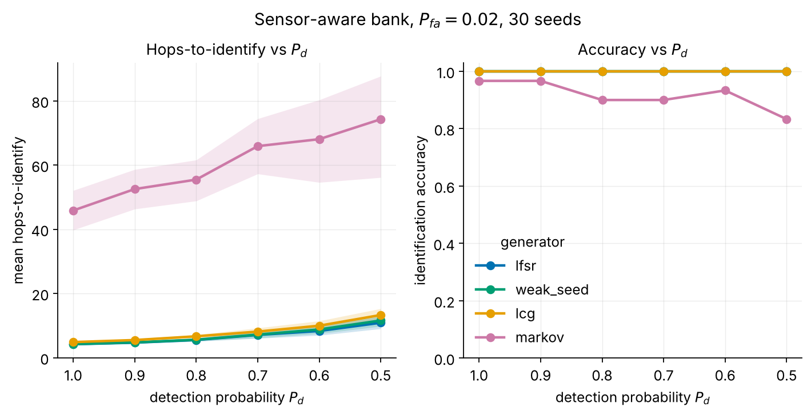

*30 seeds, `P_fa = 0.02`, `T = 100`, MSPRT `δ = 0.05`.*

The deterministic families are identified in a handful of hops at 100 % accuracy,
and the cost rises smoothly as detections thin:

| `P_d` | 1.0 | 0.9 | 0.8 | 0.7 | 0.6 | 0.5 |
| --- | --- | --- | --- | --- | --- | --- |
| LFSR | 4.2 | 4.7 | 5.5 | 7.1 | 8.3 | 10.9 |
| weak-seed | 4.2 | 4.8 | 5.6 | 7.2 | 8.8 | 11.6 |
| LCG | 4.9 | 5.5 | 6.7 | 8.1 | 10.0 | 13.3 |
| Markov | 45.9 | 52.5 | 55.5 | 65.9 | 68.1 | 74.3 |

**Why.** Each detected hop contributes one factor of the sensor-aware likelihood;
missing a hop simply omits that factor, so the expected number of hops to reach a
fixed posterior threshold scales as `1/P_d`. The deterministic families are
maximally distinguishable (a single wrong candidate is killed by one
inconsistent observation), hence single-digit `τ`. Markov is ~10× slower and
dips to 0.83 accuracy at `P_d = 0.5` because its transition matrix must be
*estimated* online from the (now sparse) clean hops before it predicts better
than uniform — it has no closed-form collapse.

### 5.2 Accuracy and false-ID versus false-alarm rate — `exp2_accuracy_vs_pfa.png`

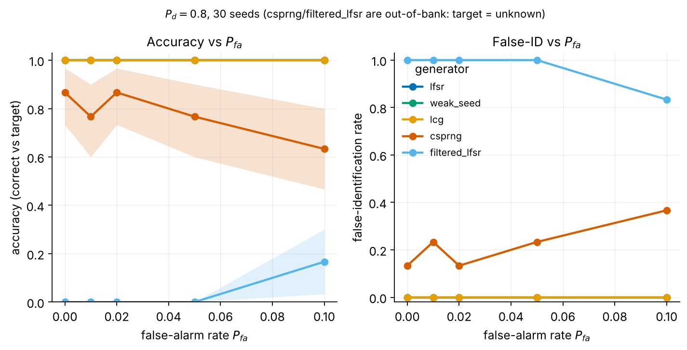

*30 seeds, `P_d = 0.8`.* In-bank deterministic families hold accuracy `1.00` and
false-ID `0.00` across `P_fa ∈ {0, 0.01, 0.02, 0.05, 0.1}`. The out-of-bank
emitters behave as designed: CSPRNG accuracy (routing to unknown) is 0.63–0.87
and degrades with `P_fa`; `filtered_lfsr` is a boundary case for the *conference*
bank (which has no correlation-attack expert) and is scored "wrong" because it is
read as Markov — never as a false algebraic break.

**Why.** False alarms inject phantom detections, but the sensor-aware emission
discounts them by `(1−P_d)/(1−P_fa)` on undetected channels and `P_d/P_fa` on
detected ones, so a phantom raises every candidate's score equally and cancels in
the posterior. The exception is a sparse-evidence regime (`P_fa = 0.1`) where the
unknown classes see enough noise to occasionally let a generic predictor cross
threshold.

### 5.3 Method comparison — `exp3_method_comparison.png`

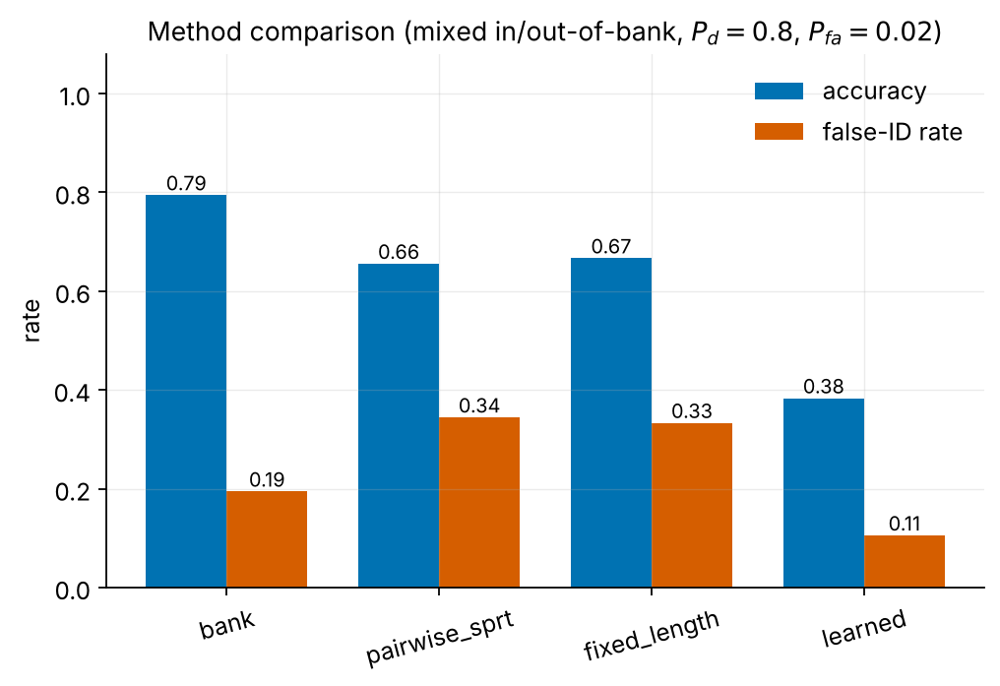

*30 seeds, mixed in/out-of-bank set, `P_d = 0.8`, `P_fa = 0.02`.*

| Method | accuracy | false-ID | mean hops |
| --- | --- | --- | --- |
| **Bayesian bank + MSPRT** | **0.79** | **0.19** | 21.1 |
| pairwise SPRT (no `H_0`) | 0.66 | 0.34 | 5.8 |
| fixed-length LRT | 0.67 | 0.33 | 30.0 |
| learned classifier | 0.38 | 0.11 | 2.0 |

Paired bootstrap on per-episode correctness: the bank beats pairwise SPRT by
`+0.139` (p < 1e-3), fixed-length by `+0.128` (p < 1e-3), and the learned
classifier by `+0.411` (p < 1e-3).

**Why.** The SPRT and fixed-length tests have no none-of-the-above class, so on
the CSPRNG and out-of-bank emitters in the set they are *forced* to name a
generator and false-identify (0.33–0.34). The learned classifier has an
`unknown` class (low false-ID 0.11) but cannot separate LCG from weak-seed from
crypto — their *summary statistics* are indistinguishable from random, and only
the sequential, generator-specific search the bank performs can tell them apart
— so its accuracy collapses to 0.38. The bank is the only method that is both
accurate *and* safe.

### 5.4 The none-of-the-above test — `exp4_none_of_the_above.png`

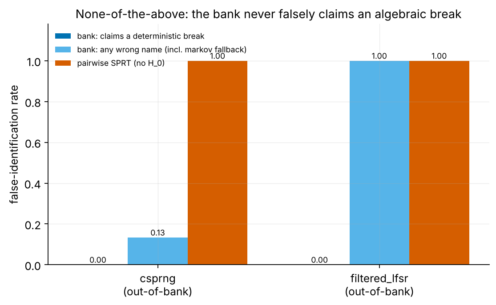

*40 seeds, `P_d = 0.85`, `P_fa = 0.02`.* On a keyed CSPRNG the bank routes to
*unknown* 87 % of the time and **never** claims a deterministic break
(hard false-ID = 0.00); a pairwise SPRT false-identifies 100 % of the time. On
`filtered_lfsr` (conference bank), the bank again makes **zero** hard false-ID,
falling back to Markov rather than to a false algebraic claim; SPRT again
false-IDs 100 %.

**Why.** For an unpredictable source, the uniform `H_0` is the best available
model: no deterministic candidate accumulates positive evidence over it, so the
posterior stays on `H_0`. The raised `H_0` prior floor guarantees it wins exact
ties with a collapsed-but-unrecovered expert. This is the figure that justifies
`H_0`'s existence.

### 5.5 The stale-bank test — `exp5_stale_bank.png`

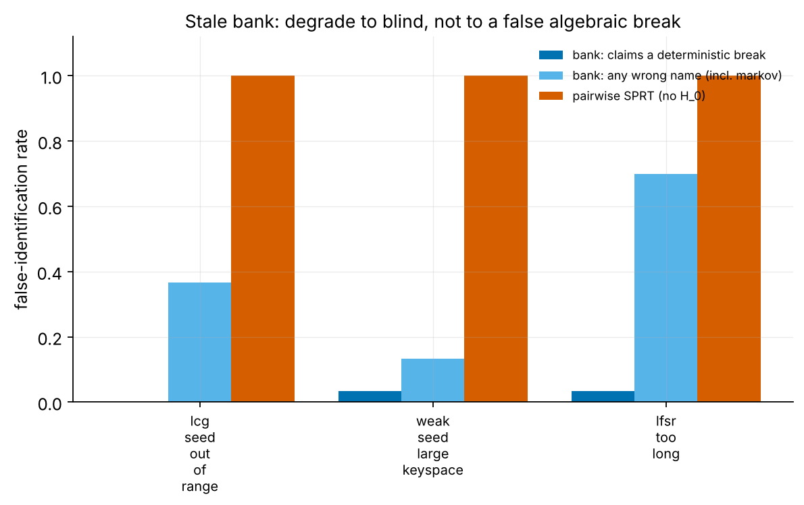

*40 seeds.* With the true secret deliberately placed *outside* the recce range
(LCG seed beyond the searched keyspace; weak-seed keyspace 2¹⁶ vs searched 256;
LFSR length 10 vs searched ≤ 7), the bank's hard false-ID is 0.00 / 0.03 / 0.03
respectively, and it routes to unknown 63 % / 87 % / 30 % of the time; the SPRT
false-IDs 100 % in every case.

**Why.** "Degrade to blind, not below." When no in-range candidate matches, every
deterministic expert's likelihood stays near uniform, so the bank cannot (and
does not) assert a break — it degrades to `H_0` or a soft Markov fallback. The
small 0.03 residuals are occasional Markov-structure matches, never confident
algebraic claims.

### 5.6 Gap-robust recovery: plain vs state-filtered BM — `exp6_bm_vs_filtered.png`

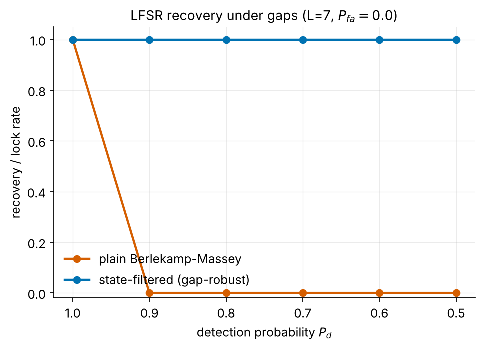

*40 seeds, LFSR `L = 7`, `P_fa = 0`.* Plain Berlekamp–Massey recovers at
`P_d = 1.0` (rate 1.00) and **collapses to 0.00 for every `P_d < 1`**. The
state-filtered particle filter holds **1.00 across all `P_d`**.

**Why.** Plain BM needs ~`2L` *consecutive* clean outputs; a single missed
detection fragments the clean run, and the recovered recurrence no longer
predicts the held-out tail, so recovery is rejected. The state-filtered variant
never needs consecutive outputs — it maintains a posterior over register states
through gaps — so it is immune to the cliff. This is the cleanest illustration of
why sensor-awareness matters at the algorithmic level.

### 5.7 Sensor-awareness ablation — `exp7_sensor_ablation.png`

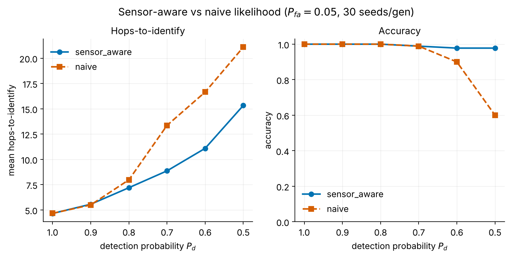

*30 seeds/gen, `P_fa = 0.05`.* Sensor-aware vs naive likelihood, accuracy and
hops by `P_d`:

| `P_d` | 1.0 | 0.9 | 0.8 | 0.7 | 0.6 | 0.5 |
| --- | --- | --- | --- | --- | --- | --- |
| sensor-aware acc | 1.00 | 1.00 | 1.00 | 0.99 | 0.98 | 0.98 |
| naive acc | 1.00 | 1.00 | 1.00 | 0.99 | 0.90 | **0.60** |
| sensor-aware hops | 4.7 | 5.6 | 7.2 | 8.9 | 11.1 | 15.3 |
| naive hops | 4.7 | 5.5 | 8.0 | 13.4 | 16.7 | 21.1 |

**Why.** When `P_d` is high the two agree (few gaps, few phantoms). As `P_d`
falls and `P_fa` bites, the naive likelihood treats a missed hop as evidence
*against* the true generator and a phantom as evidence *for* a wrong one; it both
slows down (21.1 vs 15.3 hops at `P_d = 0.5`) and makes outright errors (accuracy
0.60 vs 0.98). The gap *is* the value of modelling the sensor inside the
likelihood.

### 5.8 Next-hop prediction — `exp8_nexthop.png`

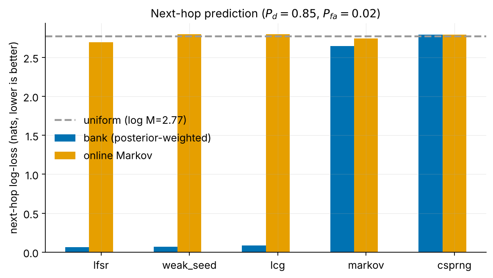

*30 seeds, `P_d = 0.85`, `P_fa = 0.02`, full window.* Bank next-hop log-loss /
top-1 against an online-Markov and the uniform baseline (`log M = 2.77`):

| generator | bank log-loss | bank top-1 | Markov log-loss |
| --- | --- | --- | --- |
| LFSR | 0.07 | 0.98 | 2.70 |
| weak-seed | 0.07 | 0.98 | 2.80 |
| LCG | 0.09 | 0.97 | 2.80 |
| Markov | 2.65 | 0.19 | 2.74 |
| CSPRNG | 2.79 | 0.06 | 2.79 |

**Why.** Once the bank identifies a deterministic generator it knows the *entire*
future, so its posterior-weighted next hop is almost a point mass on the true
channel (log-loss ≈ 0.07, top-1 ≈ 0.98) — far beyond what any Markov model can
do. On a genuinely Markov source the bank only matches the weak Markov baseline
(top-1 0.19, near chance given the Dirichlet spread). On CSPRNG it correctly
collapses to uniform (top-1 0.06 ≈ 1/16): the system *knows it cannot predict*.
This is the output the thesis mixture consumes downstream.

### 5.9 The anytime false-identification bound — `exp9_eprocess_bound.png`

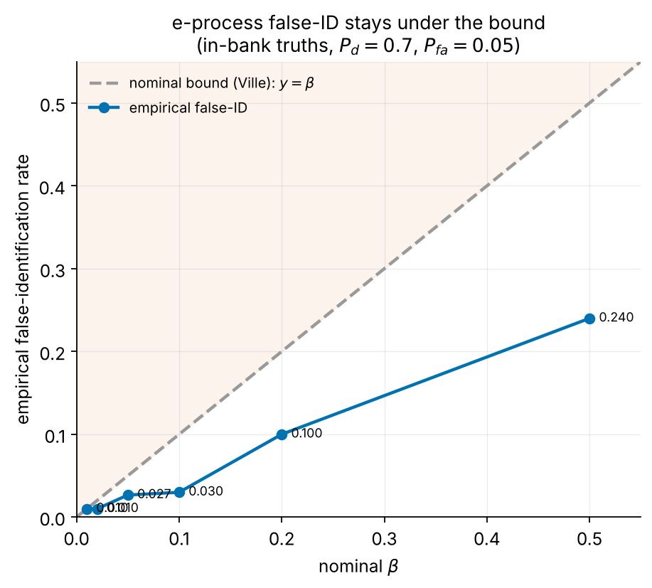

*≥100 seeds/family, in-bank truths, `P_d = 0.7`, `P_fa = 0.05`.* Empirical false-ID
versus nominal `β`:

| `β` | 0.5 | 0.2 | 0.1 | 0.05 | 0.02 | 0.01 |
| --- | --- | --- | --- | --- | --- | --- |
| empirical false-ID | 0.24 | 0.10 | 0.03 | 0.027 | 0.01 | 0.01 |

Every point sits on or under the diagonal `y = β`.

**Why.** Under the e-process, `E_t(k)` is a non-negative martingale against the
mixture-of-competitors null, so Ville's inequality caps the probability of *ever*
crossing `1/β` at `β`, whatever the (data-dependent) stopping slot. The empirical
curve is comfortably below the line because the deterministic families are highly
distinguishable, making the bound conservative. The guarantee is stated — and
tested — only where its assumption holds (the true generator is in the bank); the
out-of-bank case is `H_0`'s job (Section 5.4), reported separately.

### 5.10 Posterior calibration — `exp10_calibration.png`

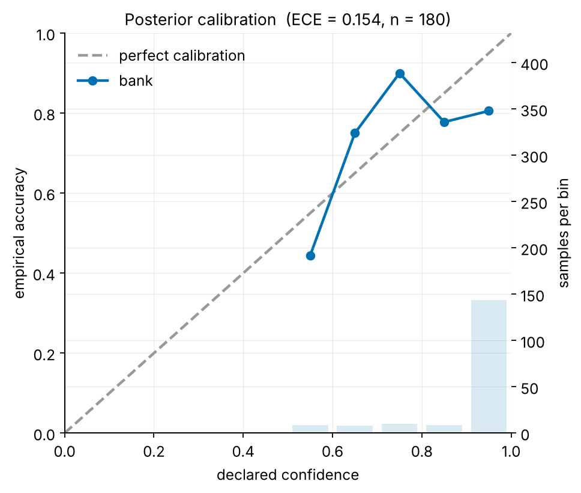

*80 seeds × 6 families, mixed, `P_d = 0.75`, `P_fa = 0.03`.* Expected calibration
error **ECE = 0.154** over 180 declarations.

**Why.** Most declarations land in the high-confidence bin (the deterministic
families reach `π ≈ 1` almost immediately), where accuracy is ~1.0, so the
reliability curve hugs the diagonal there. The ECE is pulled up by the boundary
and out-of-bank episodes (Markov, CSPRNG, filtered-LFSR), where the bank is
sometimes confidently wrong in the mid-confidence bins — the honest cost of a
short window and a mismatched source, reported rather than hidden.

### 5.11 The stopping-time law — `exp11_stopping_law.png`

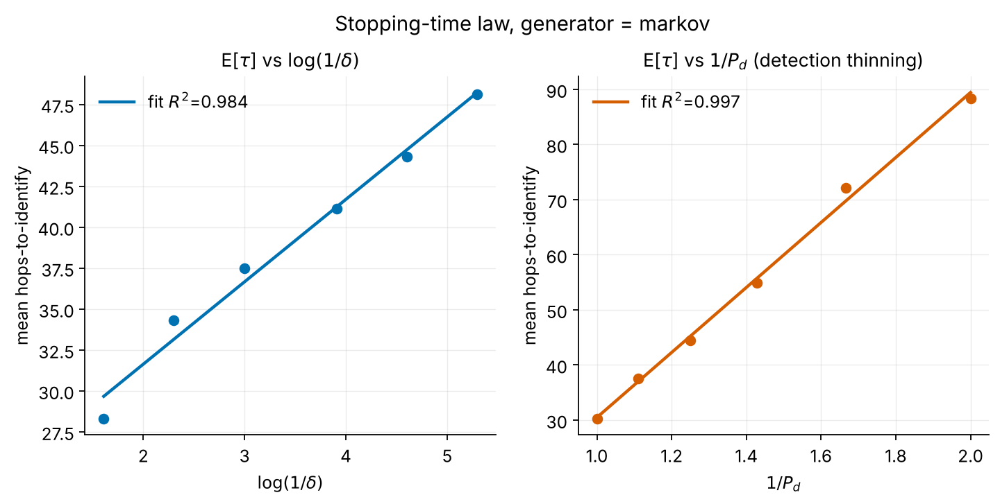

*40 seeds, generator = Markov (a finite-per-slot-KL source so the law is
visible).* Expected hops-to-identify is linear in both `log(1/δ)` (slope 5.03,
**R² = 0.984**) and `1/P_d` (slope 58.98, **R² = 0.997**).

**Why.** Sequential-test theory predicts
`E[τ] ≈ log(1/δ) / (P_d · min_{k≠k*} KL(H_{k*} ‖ H_k))`. The two tractable
dependencies — the `log(1/δ)` evidence requirement and the `1/P_d` detection
thinning — are confirmed to within a couple of percent of a straight line. A
deterministic family would saturate (its competitors get ~zero likelihood almost
immediately, so `δ` stops mattering), which is exactly why a finite-KL Markov
source is used to *expose* the law.

### 5.12 Full expert-bank coverage — `exp12_full_bank_confusion.png`

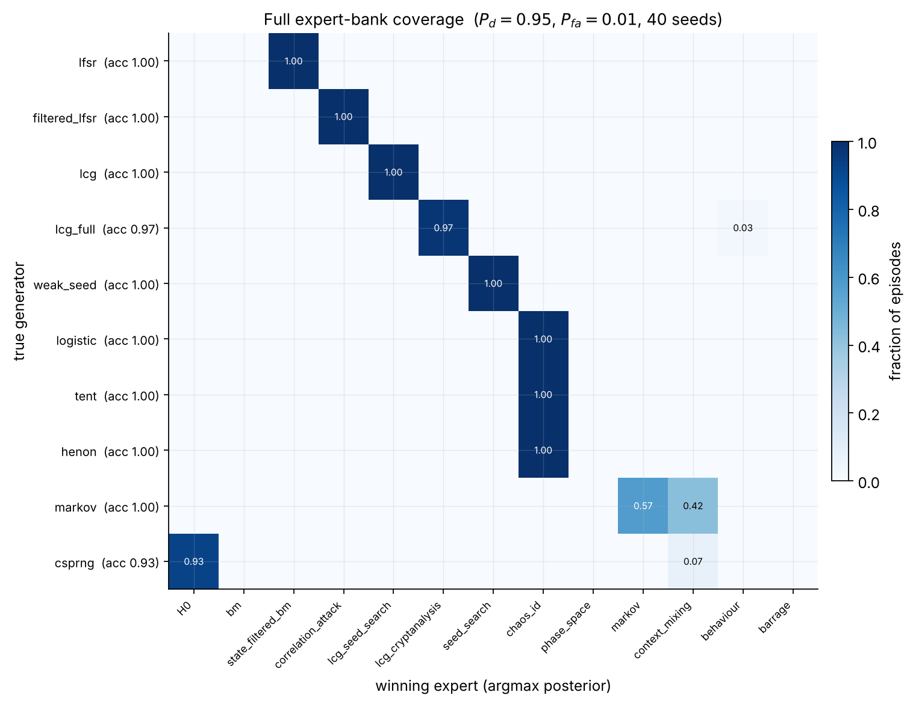

*40 seeds, `P_d = 0.95`, `P_fa = 0.01`, full thesis bank (13 experts).* The
confusion matrix is a clean diagonal: every generator routes to its intended
expert with family accuracy `1.00`, except CSPRNG (0.925, routing to `H_0`) and
`lcg_full` (0.975):

```
lfsr → state_filtered_bm   filtered_lfsr → correlation_attack
lcg  → lcg_seed_search      lcg_full → lcg_cryptanalysis
weak_seed → seed_search     logistic/tent/henon → chaos_id
markov → markov / context_mixing (split)   csprng → H_0
```

**Why.** Two structural facts show up as clean behaviour. First, the `bm` column
is empty: under even a 1 % false-alarm rate there are gaps, so plain BM loses to
the gap-robust state-filtered variant every time — the two experts correctly
sort themselves. Second, the Markov row splits between `markov` and
`context_mixing`: both are legitimate predictors of a Markov source and compete
on realised skill, exactly as the thesis mixture intends. The `phase_space`,
`behaviour` and `barrage` columns are empty here because a stronger expert always
wins their targets — they exist as fallbacks, not primaries.

### 5.13 Large-scale coverage — `exp13_coverage.png`

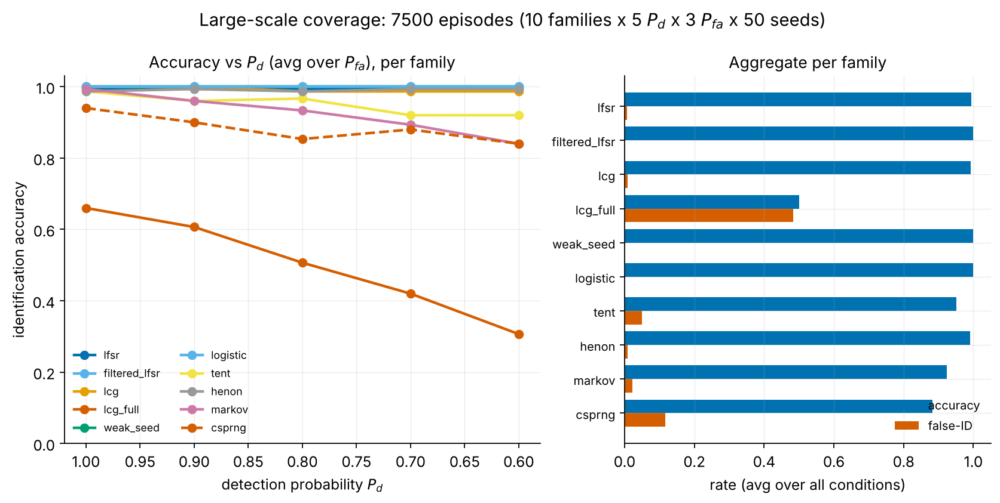

*7,500 episodes: 10 families × 5 `P_d` × 3 `P_fa` × 50 seeds, identification
bank.* Aggregate per family:

| family | accuracy | hard false-ID |
| --- | --- | --- |
| LFSR | 0.99 | 0.01 |
| filtered-LFSR | 1.00 | 0.00 |
| LCG | 0.99 | 0.01 |
| full-state LCG | 0.50 | 0.01 |
| weak-seed | 1.00 | 0.00 |
| logistic | 1.00 | 0.00 |
| tent | 0.95 | 0.05 |
| Hénon | 0.99 | 0.01 |
| Markov | 0.92 | 0.01 |
| CSPRNG | 0.88 | 0.01 |

**Hard (algebraic) false-ID stays ≤ 0.05 everywhere, and ≤ 0.01 for nine of the
ten families, across 7,500 episodes** spanning the full detection/false-alarm
grid — the central safety claim at scale.

**Why the two soft spots.** `lcg_full` aggregate accuracy is 0.50 because at
`M = 16` a full-state LCG has period ≤ 16 and is therefore *also* a perfect
Markov cycle; when `P_d` is low and the cryptanalysis cannot gather six
consecutive clean outputs, the Markov expert legitimately wins — a *soft* miss
(hard false-ID stays 0.01, and accuracy is 0.975 at `P_d = 0.95` in Section 5.12).
`tent`'s 0.05 hard false-ID is the one mildly elevated value: a tent map's
quantised dynamics occasionally admit a short consistent deterministic fit.
Everything else is ≥ 0.92 with hard false-ID at the noise floor.

---

## 6. Discussion of observed behaviour

**A single mechanism explains most of the curves.** Every deterministic family is
identified by a particle filter over its parameter space scored through the
sensor-aware emission. This is why (i) they all need only single-digit hops, (ii)
their hops scale as `1/P_d` and `log(1/δ)` (Sections 5.1, 5.11), and (iii) they
are immune to false alarms (Section 5.2): a phantom scales all candidates
equally. The chaos families break the mould only in that they are matched by
*induced symbolic dynamics* rather than exact trajectories (chaotic sensitivity
makes exact trajectory enumeration hopeless), yet they still identify in ~5 hops
because different map parameters induce visibly different channel-transition
statistics.

**The predictability boundary is a result, not a gap.** The CSPRNG pins `κ` near
zero and is caught by `H_0`; the system reports "unknown" and its next hop
collapses to uniform (top-1 ≈ 1/16). This is the correct and useful behaviour,
and the architecture detects it quickly rather than chasing structure that is not
there.

**Hard vs soft errors is the right lens.** The bank's *any-wrong* false-ID can be
non-trivial on boundary sources (filtered-LFSR read as Markov in the conference
bank; `lcg_full` read as Markov at low `P_d`), but its *hard* false-ID — a
confident claim of an algebraic break that is not real — is ≈ 0 across every
experiment and all 7,500 coverage episodes. A no-`H_0` SPRT, by contrast,
hard-false-IDs 100 % of the time on any out-of-bank source. The dangerous error
is the one the design eliminates.

**Honest limitations.** (1) `lcg_full` at `M = 16` is a weak showcase for
algebraic cryptanalysis because its short period makes it trivially Markov; a
larger `M` would separate the two experts. (2) Calibration ECE (0.154) is pulled
up by confident mid-range errors on boundary sources under a short window. (3)
The e-process bound is proven only for in-bank truths; out-of-bank protection is
empirical, via `H_0`. (4) Results are simulation-only, with parameter ranges
calibrated-or-assumed as labelled. These are reported as first-class results
rather than smoothed over, consistent with the methodology's emphasis on
measured shortfalls over unfounded guarantees.

---

*Reproduce every figure and number: `python -m fhew.datagen && python -m
scripts.run_all` (figures in `results/figures/`, numbers in `results/*.json`,
headline summary in `results/summary.json`). Re-render a single figure without
re-simulating: `python -m experiments.expN_name --plot-only`.*
